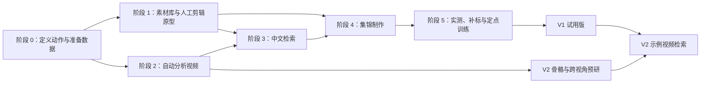

# 羽毛球技战术检索与集锦 App：实施简版

> 这份文档用于后续与 Codex 分阶段实施。先做 **V1：中文描述检索视频片段并制作集锦**；**V2：上传示例视频，查找语义或动作细节相似的片段**。支持自己拍摄的视频和有使用权的赛事视频，但两类素材要分别测试效果。

## 1. 整体要做什么

把一批羽毛球比赛视频导入素材库。用户输入“某球员交叉步后退、起跳杀球，随后上网扑球”之类的描述，App 找出对应的**候选片段**，允许按球员筛选、人工复核，再自动排成可调整的集锦并导出 MP4。

最核心的链路是：

```text
导入原视频 → 找到回合、球员、击球和移动 → 建立可搜索的事件索引
        → 将中文描述变成检索条件 → 展示候选与证据 → 人工确认 → 裁切、排序、导出
```

“所有符合动作都找齐”只能作为验收目标，不能在没有完整视频标注和实测前承诺。看不清的细动作允许标为“无法判断”。

## 2. 阶段关系



**可并行**：阶段 1 的 App 基础功能与阶段 2 的视频算法；阶段 4 的剪辑界面可先接人工标注片段开发。**必须先有**：阶段 0 的动作定义和测试素材，否则后续模型成绩无法判断。

## 3. 每个阶段做什么

### 阶段 0：定义动作、准备数据

- **做什么**：确定 V1 首批支持的查询，例如粗球种、球员、场地区域、移动方向、明显的起跳/弓步，以及少量手脚组合和多拍顺序。为每个标签写出“画面上怎样才算符合”。收集两类视频，记录使用权、机位和球员身份。
- **需要的数据**：从真实视频中选一批完整回合或连续视频，人工标出每次击球的时间和球员、移动区间、可见动作及“无法判断”。另收集真实中文查询及正确结果。测试视频按**整场比赛**与训练视频分开，且分别包含个人录像和转播。
- **开源参考**：[ShuttleSet](https://github.com/wywyWang/CoachAI-Projects/tree/main/ShuttleSet)可参考逐拍球种和事件字段；它不能替代自己的脚步、多拍及跨机位标注。公开视频/数据集的标注许可与比赛画面使用权要分别核查。
- **完成标志**：有一份简短动作词表、一份统一事件格式，以及能由人复核的测试片段。没有这一步，先不训练模型。

### 阶段 1：做能用的素材库和人工剪辑原型

- **做什么**：导入视频、生成缩略图、按球员/标签浏览；允许人工标记片段并导出一个简单集锦。先让完整产品流程跑通，即使动作标签暂时全靠人标。
- **技术与开源方案**：[FFmpeg](https://ffmpeg.org/)处理视频元信息、预览、裁切和编码；[OpenTimelineIO](https://github.com/AcademySoftwareFoundation/OpenTimelineIO)可保存可编辑时间线；本地数据库保存视频、球员、事件和源片时间码。
- **模型/GPU**：此阶段不需要 AI 模型；5090 可用于硬件解码和导出编码，但 CPU 方案也应可工作。
- **完成标志**：用户能从原视频手工找到片段、筛选球员、调整顺序并导出 MP4；重新打开工程不丢标注。

### 阶段 2：自动分析视频，建立事件索引

- **做什么**：先区分有效比赛画面、转播回放和特写；再找球场、跟踪球员、定位击球和移动区间。输出“谁在什么时间、什么区域做了什么”的事件表。优先做粗动作，细步法与细球种仅在画面证据足够时给出。
- **技术与开源方案**：[OpenCV](https://opencv.org/)用于球场定位与坐标变换；[ByteTrack](https://github.com/FoundationVision/ByteTrack)提供镜头内球员跟踪起点；[MMPose](https://github.com/open-mmlab/mmpose)提取人体姿态；[TrackNetV3](https://github.com/qaz812345/TrackNetV3)可作为羽球轨迹实验起点。击球时刻、跨镜头球员身份和完整脚步过程仍需针对自己素材验证或开发。
- **模型/GPU**：先用 5090 对少量真实素材跑现成模型并测耗时；球员跟踪和姿态可并行研发。H200 用于较大批量或更大模型实验。此阶段**不预设要训练新模型**。
- **完成标志**：事件能准确指回原视频时间和球员；分别报告个人录像、转播和不同机位的漏检、错人、动作混淆。

### 阶段 3：让中文描述真正搜到片段

- **做什么**：用 LLM 把中文改写为明确条件，例如“球员 A → 后退 → 起跳杀球 → 上网扑球”；用事件索引执行时间顺序查询。同时试通用文字到视频模型找候选，再比较或融合两条路线。
- **模型与开源方案**：本地中文指令模型（例如 [Qwen3](https://github.com/QwenLM/Qwen3)）负责**理解查询**，不负责凭空断定原视频发生了什么；[Qwen3-VL-Embedding](https://github.com/QwenLM/Qwen3-VL-Embedding)可作为文字与短视频向量检索基线。通用视频模型抽帧可能漏掉瞬时击球，必须在羽球测试集实测。
- **GPU**：先在 5090 上测试小模型和短片段，长窗口或较大批量再试 H200；以实测显存和速度决定部署方式。
- **需要的数据**：阶段 0 的人工真值、中文查询、只差一步或顺序的难负例；按单拍、纯脚步、手脚结合、多拍分别测试。
- **完成标志**：能展示命中条件、球员、原片位置和不确定原因；用户能修改解析条件并确认候选。**LLM 与骨骼路线都试，但只保留有实测收益的部分。**

### 阶段 4：把检索结果做成集锦

- **做什么**：用户勾选候选；系统给每段动作保留准备、击球和结果的前后文，合并重叠片段，去除转播回放重复，提供排序、标题、慢放与边界微调，最后导出视频。
- **技术与开源方案**：延用 FFmpeg 编码，OpenTimelineIO 保存剪辑工程；始终保留到源文件和源时间码的引用，不用生成式视频重造比赛画面。
- **模型/GPU**：核心是视频处理和编辑界面；5090 负责可用格式的硬件编码，H200 不承担最终编码。
- **完成标志**：成片不串球员、不重复同一回放、音画同步；用户能回到原片核查每一段。

### 阶段 5：实测，再决定是否训练

- **做什么**：在没有参与调参的完整比赛视频上，分别测“找到多少真实动作”“前排候选有多准”“做完一个集锦花多久”“视频导出是否稳定”。追踪漏检原因，再补相应标注。
- **何时训练**：击球漏检就优化击球检测；脚步混淆就补脚步区间并训练小型时序分类器，可借鉴 [MMAction2](https://github.com/open-mmlab/mmaction2) 的动作模型训练框架；通用视频向量确有明显短板时才考虑微调。**不从零训练基础大模型。**
- **GPU**：小型检测/分类模型先试 5090；长序列或较大模型微调再用 H200。训练时长和 100 小时视频的处理时长都要用真实素材测速，不能从显卡型号直接推断。
- **完成标志**：两类素材分别出测试报告；只把通过测试的动作类别和机位写进 V1 支持范围。

## 4. V2：示例视频匹配

V1 稳定后，先把示例视频也解析成阶段 2 的事件序列，查找**相同技战术语义**。若要查找“动作细节很像”，再比较时间连续的骨骼、球员在场地上的路径和球路；需要额外标注“同类动作中哪些更相似”的成对样本，并单独验证跨机位效果。骨骼提取实验可与 V1 并行，正式功能依赖 V1 的可靠索引。

上述开源方案都是候选组件，不是现成的完整羽毛球检索系统。产品发布前分别核对代码、模型权重和视频素材的许可；[FFmpeg 的构建选项也会影响其许可](https://www.ffmpeg.org/legal.html)。

## 5. 给后续 Codex 对话的执行约定

每次以本文件为范围说明，并指定一个阶段，例如：**“请阅读 `PROJECT_PLAN_SIMPLE.md`，只实施阶段 1；先检查现有代码，给出最小可运行版本，并用一段真实视频验证导入、手工标注和 MP4 导出。”** 阶段 2 起每次都同时报告模型错误、人工复核量、不同机位表现和处理速度。详细的数据字段与算力估算另见 [PRODUCT_ROADMAP.md](PRODUCT_ROADMAP.md)。
