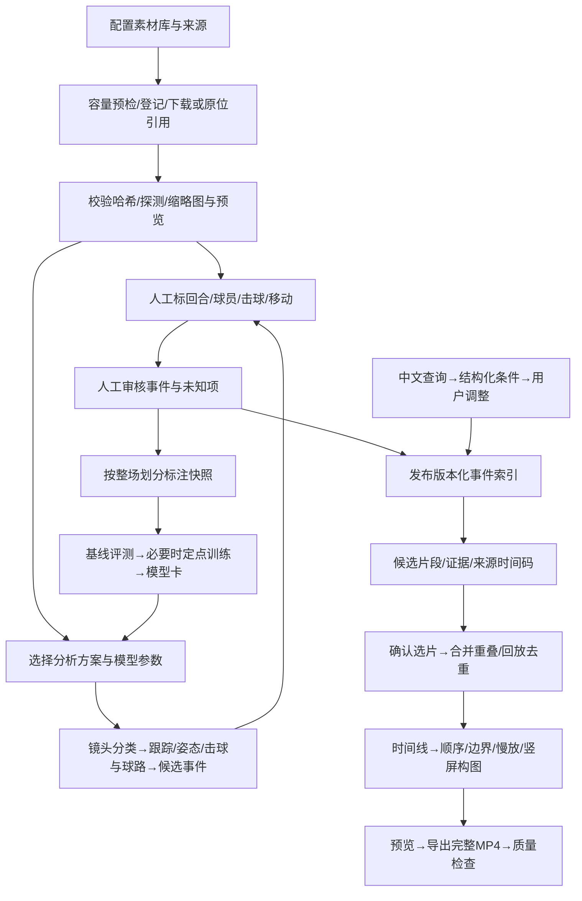

# 架构与工作流 v0.1

状态：实施基线；开发前允许在模块设计中记录兼容性修正。详细结构先建立，第一轮只逐步实做能验证的部分。

## 1. 选型与部署

采用模块化单体控制面，加独立计算进程。Python FastAPI 提供 API，Jinja2 模板与少量 HTMX/原生 JavaScript 提供 Web 交互和视频播放器；不要求额外前端构建链。页面通过应用服务调用领域模块，不在页面回调中加载模型或做长视频编码。

业务服务和轻量任务 worker 用独立 Python 环境；模型训练/推理在 WSL Ubuntu 的独立 Conda 环境；FFmpeg 在媒体环境中执行。先提供本机 CPU 可运行方案。核心包不依赖 torch、CUDA、MMCV 或某个标注产品的私有对象。

首轮 DB 用 SQLite + 明确迁移、事务、外键和持久 job 表；仅一个控制面服务、一组受控 worker。SQLite 主数据库放 WSL 原生 Linux 文件系统，不把 WAL 数据库跨 Windows/WSL 共享；备份输出到 D:\video\platform\backups，并把原生路径实际占用计入 platform 配额。Windows 本地开发可使用其独立本地 DB，不能同时操作同一数据库文件。后续并发需求出现时替换 PostgreSQL，不改变领域接口。

## 2. 模块边界

| 模块 | 负责 | 输入/输出 | 不负责 |
|---|---|---|---|
| library | 数据源搜索、清单、受限下载、哈希、格式探测、许可记录 | source manifest → Asset | 不直接写业务DB、训练标签 |
| storage/runtime | 根目录映射、路径校验、容量、产物登记、任务和资源租约 | asset_id/relative_path、Job、Artifact | 不理解动作细类 |
| annotation | 内置区间标记、球员与回合、标注工具适配、版本/审核 | 视频/预标注 → Event revisions | 不把预测自动变成真值 |
| analysis/models | 镜头、回合、击球、跟踪、姿态、时序分类/视频向量 | Job request → 进度/事件/特征/报告 | 不操作页面、不占有业务DB |
| retrieval | 中文解析、条件编辑、结构化序列查询、可选向量召回融合 | QuerySpec → Candidate + evidence | 不虚构缺失证据 |
| timeline/render | 去重、前后文、排序、裁切/慢放/字幕、9:16合成编码 | Timeline → MP4 + 源片映射 + QA | 不认定动作标签、生成假比赛画面 |
| platform | 各模块用例编排、配置、API、Web界面、审计 | 用户操作 → 领域服务/Job | 不引入训练依赖 |

每个计算模块提供 Python 库或 CLI 适配端口。跨环境首先用 JSON 文件/JSONL 进度和子进程调用；需要常驻服务再补 HTTP 适配，不要求第一天部署复杂微服务。任意输入输出先验证统一合同。

## 3. 数据链与人工审核点

无模型时 D→G→H→L 必须可用。模型候选与人工确认分别保留，训练快照只取明确审核的标签，不覆盖人工修正。

## 4. 标注工具

平台内置最小视频起止点和属性编辑，以保证闭环。优先评估自托管 Label Studio：官方 [TimelineLabels](https://labelstud.io/tags/timelinelabels) 支持单帧与帧段标签，[VideoRectangle](https://labelstud.io/tags/videorectangle) 用于视频对象跟踪。必须实测所安装社区版能完成的导入、编辑、导出与回写；不把仅有一个外链按钮称为已完成集成。

通过 adapter 转成 Event，保存 task/annotation ID、工具版本和原始导出引用。帧号必须结合实际PTS/代理映射还原毫秒；不假设帧序号从0开始或固定fps，也不能给所有代理简单除同一个fps。关键点/复杂轨迹可以评估 [CVAT API](https://docs.cvat.ai/docs/api_sdk/sdk/reference/apis/)，首轮不同时维护两个重型标注系统。嵌入受浏览器策略限制时使用同源代理或清晰的独立标签页入口，保留回写通路。

## 5. 持久任务与资源

Job 状态：queued → running → succeeded / failed / cancelled / blocked；依赖未满足先 blocked，条件满足后显式重新排队。cancel_requested 是控制字段，不是虚假的已取消。

- 创建任务保存 input、模型版本、参数快照、代码提交和幂等键，返回202/job_id。
- 独立worker事务领取任务，写 owner、lease_expires_at 与心跳。租约过期恢复为 interrupted/可重试记录，再决定排队；不能把程序重启误报成功。
- 每阶段保存 checkpoint/artifact，临时文件完成验证后原子改名；幂等处理与最大重试次数避免重复入库/导出。
- 进度含 stage、current、total、unit；无可靠总量时显示不确定进度。实时轮询或SSE读取持久事件，断线重连可按seq续读。
- GPU 同时默认只运行一个重型任务，登记gpu_id与lease；CPU/IO任务有独立并发限制。显存不足标明配置、峰值、替代方案和重试结果。
- 取消要终止本任务子进程树，并保留错误和可恢复产物；不终止其他用户进程。
- 大文件下载、解压、抽帧和渲染均受容量预留/配额约束，磁盘不足时有可理解失败原因。

FastAPI 官方建议重型计算考虑独立任务工具，而非普通 [BackgroundTasks](https://fastapi.tiangolo.com/tutorial/background-tasks/)。此项目首轮用单机持久队列，保留后续 Celery 等执行适配器的替换点。

## 6. Web页面与操作

| 页面 | 必需操作 |
|---|---|
| 总览/工作流 | 展示导入、分析、审核、索引、检索、渲染各阶段、依赖、阻塞与最近错误 |
| 素材库 | 配置多个逻辑库、扫描/导入manifest、搜索球员/比赛/机位、视频预览、授权与容量 |
| 标注工作台 | 播放/定位、区间和击球时间窗、球员/标签/unknown、保存与修订、打开外部工具/同步 |
| 模型与分析 | 可用能力与未安装状态、模型版本/环境、参数表单、健康检测、启动/取消/重试、日志和阶段进度 |
| 检索 | 中文输入、可编辑解析条件、规则/向量路线、按球员过滤、原片证据和待确认队列 |
| 集锦 | 已选片段、上下文和去重、拖动或按钮排序、边界/慢速/标题、9:16预览、完整成片下载 |
| 设置/实验 | 库路径、端点、模型配置、LLM连接测试、环境/显存、实验报告与问题入口 |

LLM配置含provider、base_url、model、timeout、密钥环境变量名；密钥不返回给浏览器或进入日志/提交。无密钥时能用受限规则解析和手工条件运行。LLM输出只可成为经schema验证的QuerySpec，不能直接执行SQL或shell。只把用户输入的查询发往所配置端点；视频/私人素材不因开启LLM自动外传。

## 7. 主要API资源与解耦点

统一前缀 `/api/v1`：`libraries`、`assets`（含manifest import、probe、受控media）、`players`、`events`（revision/review/import/export）、`models`（health/capabilities）、`jobs`（create/detail/logs/cancel/retry）、`queries`（parse/search）、`timelines`（preview/render）、`settings/llm`（masked config/test）、`reports`。平台任务发布实际OpenAPI和运行示例。

文件跨模块交接目录：`D:\video\<owner>\handoff`。生产DB只能由平台服务写；其他任务提交manifest、events、model card、timeline等，通过API或导入器校验入库。

## 8. 稳定性和验证

必须覆盖：重启标注不丢；同一导入不复制；查询不串球员/不跨回合；对手插入一拍不破坏同一球员事件先后；未知≠阴性；取消和worker中断可辨；离线模型不伪造成功；非法路径不能读取任意主机文件；一次完整CPU MP4导出、无音轨输入、分辨率/fps混合、慢放音画同步；真实素材与合成烟测单独报告。

训练效果门槛、测试留出与案例顺序见 ACCEPTANCE。任何“完成”都必须同时对应代码、可复现命令、真实运行结果和明确剩余限制。
