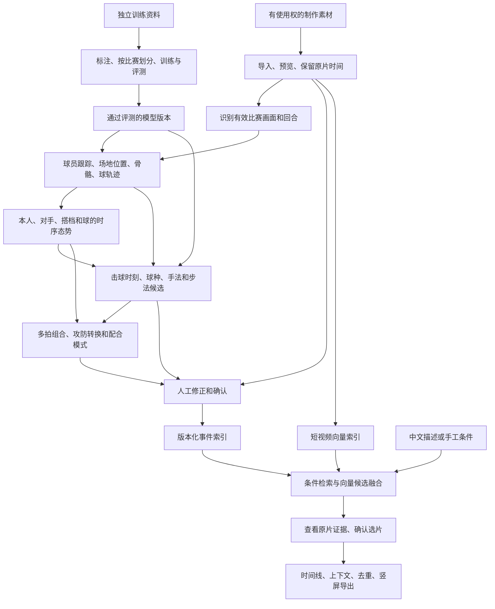

# 羽毛球技战术理解、检索与集锦：完整业务能力与落地方案

编写日期：2026-10-02。面向产品评估与后续排期。

现状依据：本地 `main` 的 `6db0064` 及截至2026-09-29保存的真实实验；开源入口于本次重新核查。本文件是方案，不是新增运行成绩；没有重跑模型，也不代表旧服务今天仍在线。正式达标状态继续以 [阶段验收表](STAGE_ACCEPTANCE.md) 为准。

本次修订落实用户的范围澄清：**展搓、收搓、后退小跳启动只是例子。产品应覆盖适合视频识别的击球手法、步法和技战术，并结合球、本人、对手，以及双打搭档的实际态势判断。** 历史文档中的“三目标”不再代表产品边界；原验收案例和失败证据保留，新范围另设断言，不能拿新方案冲掉旧结果。

快速阅读：第1节看可行性；第2节看完整技战术目录与态势；第3–4节看缺什么、训练什么；第5–7节看标注量、硬件、投入和验收；第9–10节看已有系统怎样判定及详细论文依据。

## 1. 先看结论

**推荐做成“感知比赛事实 → 结合态势识别手法与步法 → 识别多拍模式 → 检索、审核、成片”的产品。** 自动结果保留原片证据和不确定性，人工确认可反过来形成训练数据。当前业务底座已有基础，核心缺口是可靠的事件链及双方互动建模。

建议先在**机位稳定、人体和脚部清楚的单打**上跑通完整链，同时建立覆盖单打、双打的标签目录。再按数据条件开放各类能力；双打、频繁切镜、远端细手法、个人录像和跨机位分别验证。交付分批，不把总需求缩成几个示例。

| 可以做出的产品层次 | 可行性判断 | 最大前提 |
|---|---|---|
| 人工标注后，用中文条件找片段并做竖屏集锦 | 高；工程研究流程已通，仍需真人完成正式业务验收 | 真实身份、动作审核、素材用途与成片听感确认 |
| 自动预标回合、球员、球路和粗动作，人工修正后检索 | 中高；适合下一轮重点投入 | 把多个模型的时间轴、球员身份和事件串起来 |
| 自动识别击球、移动、回位及其组合 | 中到高难度；应分层、多标签训练，逐类开放 | 真实动作定义、可见性、时间对齐和独立标注；目前未达标 |
| 结合双方态势识别压后场、杀上网、攻防转换、双打轮转等模式 | 有可借鉴的规则、时序网络和互动建模研究 | 不能只看击球者；必须有球路、对手/搭档及前后拍证据 |
| 判断主观意图、最优决策，以及任意比赛的完整直播分析 | 高风险研究项，不作为首版交付承诺 | 专家解释与客观事实分开；决策价值需额外评测，实时需持续负载实测 |

本轮查到的工作可以分别提供球轨迹、姿态、粗球种、动作定位、逐拍预测、战术模式和可视化分析。**没有核实到一个可直接下载、已公开完整权重、能从任意整场视频可靠输出全部手法＋步法＋战术意图的现成系统。** 这不妨碍落地：复用感知模型，训练小型专用分类器，以结构化态势和可解释规则连接各层，能节省大量从零开发成本。

最重要的限制是可见性：没拍清的手腕、拍面或脚部不能仅凭“战术上应该这样打”补成事实。系统可说“这段符合网前调动模式”，同时保留“具体搓法未知”。

## 2. 完整业务怎样串起来

训练资料可以训练模型；**训练原片及其衍生片段不能进入制作素材库或集锦**。模型应用到有使用权的制作素材后，才产生可供制作的候选。

这里有两个不同索引：**事件索引**保存“谁在什么时候做了什么”，适合球员和先后顺序；**向量索引**保存视频内容的数字特征，适合找相似候选。后者的相似分数不是识别准确率，也不能单独证明多拍顺序。

### 2.1 要覆盖哪些技战术：先分层，再逐项开放

以下是面向本产品的**候选目录**，用于整理资料和设计标注，并非所有项目已能自动识别，也不是声称存在全球统一、穷尽所有动作的中文术语表。组织原则参考BWF教练教材的移动、击球、战术三部分，以及ShuttleSet/FineBadminton的研究字段；细项结合本产品需求拟定，需教练审定别名、边界和反例。[BWF Level 1教材](https://badminton.lv/faili/bwf_coach_education_coaches_manual_l1-2nd-edition-midres.pdf)、[Level 2教材](https://www.badminton-israel.co.il/newsNdata/General/CoachEducationBWF/BWF_Coach_Manual_Level_2.pdf)。

两份是BWF编写、国家羽协托管的原版教材。便于核对：L1第二版（2017）印刷页51–71为移动、73–130为击球、132–180为战术；L2第一版（2013）页58–63涉及正反手两种旋转网前球。不同PDF阅读器页码可能带封面偏移。

| 层次 / 家族 | 应纳入目录的内容 | 必需证据与可用性判断 |
|---|---|---|
| 击球基础属性 | 正/反手、头顶绕头、持拍侧、触球前后阶段；高/中/低击球点 | 上肢、球拍与触球附近视频；高度只能在可靠几何下定量。中—高难度 |
| 精细击球机制 | 握拍及转换、拍面变化、切削/反切、触球前后的拍头运动 | 需要足够清晰的手拍局部；不能由出球落点反推唯一机制。高—研究级 |
| 发球与接发 | 短发、长发、偷后场/平快发球；接发放网、推扑、挑后场、平抽 | 发接发身份、球路、起始站位；“偷”含策略解释，先记快长发球事实。中 |
| 后场击球 | 高远/平高、吊球、劈吊/滑板等切击、杀球/点杀/跳杀，正反手与直斜线属性 | 全身＋手拍动作＋出球方向；动作与球路分开标。粗类中，切击细分高 |
| 中场处理 | 平抽、平挡、推球、拦截、接杀挡网/抽挡/挑球、身体附近处理 | 来球和触球时机、双方位置；不能把所有低平球都叫平抽。中—高 |
| 网前处理 | 放网、搓球及展/收等细分、勾对角、推后场、挑球、扑球、封网 | 近网位置与出球轨迹，细分还需手拍证据。粗类中，细手法高—研究级 |
| 动作变式 | 停顿、持拍动作一致后变线、假动作、击球节奏变化 | 比较触球前动作与实际出球；“骗到对手”还要对手反应，不能只看动作姿态。高 |
| 启动与调整 | 准备、分腿垫步/启动小跳、方向性启动、重心转移、小碎步调整 | 脚、髋、时序与对手击球时刻；这些名称可重叠，要定义阶段。高 |
| 位移基本单元 | 并步、交叉步、跑步、蹬跨/弓步、跳步、转身 | 连续骨骼和脚部视频；以运动员身体及球场方向表述。中—高 |
| 到位与击球步法 | 前/侧/后场到位、后退衔接、剪式/换步起跳、侧向起跳、单/双脚支撑及落地 | 从启动到击球到落地的完整过程；后退小跳只是其中一个待定义例子。高 |
| 回位与再启动 | 蹬回、交叉/并步回位、回位方向和位置、连续启动时机 | 自己落地到对手下一次击球的过程；回位不机械等于回几何中心。中—高 |
| 球路属性 | 起点、方向、直/斜线、深浅、快慢、过网高度、飞行弧线 | 2D轨迹先可用；真实速度、三维高度、旋转和精确落点需更强证据。中到研究级 |
| 单拍态势 | 前后左右位置、双方距离、移动方向、平衡/受压、可覆盖空当 | 结合来球和对手；站后场不自动等于被动，画面停留不等于疲劳。高 |
| 单打多拍模式 | 拉开前后场、四角调动、连续压某侧/区域、重复落点后变线、杀上网/吊上网、网前争夺、守中反攻、节奏变化 | 至少完整相关多拍、双方位置及回球；先识别可操作定义下的模式。中—高 |
| 双打发接发配合 | 发接发与第三拍衔接、前场抢网、后场接应、接发后补位 | 四人身份、队伍和击球顺序；不把单打模型输出直接当双打结论。高 |
| 双打阵形与轮转 | 前后/左右站位、攻防阵形转换、前封后攻、进攻轮转、补位、交叉接应 | 连续四人轨迹、球路、相对角色；单帧前后站位不是已确认进攻。高 |
| 双打施压模式 | 追身、夹缝、连续压同一人、调开搭档、平抽争主动、防守反击 | 必须绑定被针对的人、搭档覆盖和结果；“故意针对”属于解释。高 |
| 结果与评估 | 是否回到位、对手下一拍选择、落点分布、回合结果、模式使用率 | 先统计可观测结果；非受迫失误、动作质量、决策优劣需专家标准。中到研究级 |
| 意图与建议 | 争取回位时间、诱导回球、消耗体能、针对弱点、替代选择 | 作为有证据的解释或预测；单段视频通常不能验证主观意图。研究级 |

同一拍可同时是“反手＋网前处理＋斜线”，伴随“蹬跨到位＋回位”，并属于“前后调动”片段；不能硬塞进一个互斥大分类。目录采用稳定ID、父类、别名、观察判据、所需证据、易混项、适用单/双打和版本。**所有家族纳入规划，具体标签的支持状态逐项公布**：待定义、可人工标、可自动候选、已通过留出评测。

跨数据集映射要记录“完全对应 / 原标签更粗 / 更细 / 部分重叠 / 无对应”。例如ShuttleSet的网前类不能自动升级成展搓或收搓；一份数据叫drop/切球，也不能不看其定义就当成另一个体系的全部吊球。保留原标签，避免翻译造成假真值。

### 2.2 “态势”具体是什么，怎样进入判断

| 状态组 | 每一拍要记录什么 | 怎样得到 / 不确定时怎么办 |
|---|---|---|
| 时间与参与者 | 原片PTS、回合、击球者、对手、搭档、换边、左右手 | 时间轴与身份关联；不明身份用匿名ID，不凭衣服颜色跨场关联 |
| 来球 | 上一拍击球点、来球方向/弧线、可见球点、距离触球的时间 | TrackNet＋击球检测；2D观测、插值和3D估计分开保存 |
| 本人状态 | 场地位置、移动方向、身体朝向、支撑脚、触球点、回位进度 | 姿态、脚部和场地映射；朝向/支撑脚可unknown |
| 对手状态 | 对手位置、速度方向、回位/启动时机、下一拍接触位置 | 不能只跟击球者；可描述“向前移动”，慎称“重心被骗” |
| 双打关系 | 两队成员、前后/左右关系、接球人、搭档覆盖与角色变更 | 四人持续轨迹；换位或遮挡时人工修正，角色不是固定姓名属性 |
| 出球与响应 | 出球方向、预计/实际终点、对手回球、己方后续移动 | 对手提前接到球时，“自然落点”只是预测，不标成实测落地 |
| 回合背景 | 前几拍、比分、发接发身份、回合结果 | OCR/人工确认，字段缺失不臆造；比分不是所有动作识别必需输入 |
| 证据质量 | 可见性、校准版本、缺失区间、是否用了未来帧 | 每个字段保留来源与状态，不能一条高置信度覆盖全部层次 |

场地坐标统一为运动员所在场端和持拍侧可解释的方向，保留原始坐标。换边、左手运动员和镜像视频单独处理。速度必须用真实时间差，不能假设每个视频都是30fps。

**离线复盘和实时判断分开。** 复盘可借声明窗口内的后续球路确认本拍类别；击球前决策或实时分析只能使用当时已出现的信息。记录每个输出最晚用到的源时间。因果预测的输入不得泄漏未来回球或最终胜负；未来结果可以作为监督目标，不能提前放入预测输入。

### 2.3 为什么同一动作必须结合对手判断

| 可见动作 | 缺少态势时容易误判 | 本产品应怎样给结论 |
|---|---|---|
| 打后场高球 | 全部归为防守，或都说在压制对手 | 对照来球压力、本人到位、对手前后位置和自己回位；先报告“打深＋对手后退”，再给策略解释 |
| 杀球后向前移动 | 看到杀球就叫杀上网 | 同一人、同回合、杀球后前移及后续衔接都满足才给组合标签；起跳只是动作属性 |
| 网前变线 | 自动称“假动作骗过对手” | 手拍证据支持变线，对手轨迹支持反向调整时分别报告；意图及被欺骗仍需审核 |
| 向后启动 | 把任何后退都当后退小跳 | 从准备、离地、落地与移动顺序识别步法，关联对手触球时刻；缺脚部就只记后退 |
| 双打前后站位 | 自动称前封后攻、轮转成功 | 看球路、接球人、搭档补位和持续位置关系；“阵形”“轮转”“产生效果”分别判断 |

因此建议采用**局部动作证据＋全局互动状态**的两路输入：态势帮助排除不合理候选，手拍和脚部证据确认动作细节；两路矛盾时交给人工，不用战术合理性抹掉视觉不确定性。

## 3. 能力清单：现在能用什么，还差什么

难度是基于本项目基础的工程判断：**低**=以已有组件接入为主；**中**=需要适配、标注和真实测试；**高**=明显受数据或识别效果制约；**研究级**=没有可承诺的达标路径。难度不等于工期，也不是论文结论。

“可用”均指注明范围内的研究能力；表中的短名称不是新增模型卡状态。

| 能力与业务需求 | 当前可用性 | 推荐实施与人工兜底 | 难度 / 责任 |
|---|---|---|---|
| 数据入库、来源、许可、去重、训练/制作隔离 | 已有实现和真实验证 | 继续按 Asset 清单只读引用原片；补真实比赛分组和可制作素材 | 低—中；library/platform |
| 给训练专用视频补标、纠正预标注 | 缺独立训练标注入口；现有制作入口会拒绝这些视频 | 新增隔离训练项目，复用标注工具并输出训练标注快照，禁止流入制作事件/时间线 | 中，需先补；platform/models |
| 流畅预览、逐帧、局部放大、保存标注 | 有界代理与原帧核查已通；流畅性未过 | 复用 FFmpeg、内置工作台和 Label Studio；定位约1秒目标帧回调等待，不先盲换解码器 | 中；platform |
| 有效比赛画面、回放、特写和回合切分 | 自动链未完成 | 镜头检测生成候选，人工修订回合；必要时训练小型画面分类头 | 中；models/platform |
| 谁在打球、同一个人如何跨帧关联 | 已有匿名跟踪，稳定身份未过 | YOLO姿态＋ByteTrack＋场地区域筛选；每场人工绑定姓名，切镜/换边重新核查 | 单打中，双打高；models |
| 球员在前场/后场、向哪里移动 | 姿态有输出，可靠场地位置链未过 | 每镜头人工确认球场对应点，OpenCV映射脚点；失效时不输出假坐标 | 中；models/platform |
| 羽毛球在哪里、球路怎样变化 | TrackNet真实小窗已通，仍有漏点 | 先复用；标记观测、缺失、推断，人工纠正重要窗口后再考虑微调 | 中—高；models |
| 每一拍何时击球、由谁击球 | 缺可靠自动事件 | 球轨迹与手腕运动提出候选，人工点选；训练击球时刻网络见第4节 | 高，优先补；models |
| 杀球、挑球、放网等粗球种 | BST权重已有，实际输入不合格，尚未跑通 | 先补连续姿态、球路和击球边界；不靠补零凑输入 | 中—高；models |
| 启动、移动、到位、击球支撑、落地及回位步法 | 无覆盖该体系的已训练模型 | 骨骼时序＋脚部局部视频，分阶段、多标签；质心移动不冒充脚步类型 | 高；models＋专家 |
| 正反手、切击、旋转网前球等手法及其变式 | 无合格细手法真值和目标模型 | 上肢＋手/拍局部视频＋球路；先验证可见性，分家族开放 | 粗属性中，细分高—研究级；models＋专家 |
| 双方/四人态势与动作联合判断 | 未实现完整状态与互动层 | 同时跟踪球、对手和搭档，保存逐拍状态；小型关系网络辅助视觉分类 | 高；models/platform |
| 多拍技战术模式、单打调动、双打配合 | 事件规则部分已有；完整模式库未实现 | 先用审核事件＋版本化规则，再按错误训练互动时序模型 | 事实模式中—高；models/platform |
| 意图解释、决策评价与下一拍预测 | 未实现，不能由已有特征推断已可用 | 专门输出假设、预测和适用范围；证据不足拒绝，不回写成观察标签 | 研究级；models＋专家 |
| 中文理解和条件编辑 | 规则解析可用；本地0.6B实验未过 | 规则兜底，试更强小型指令模型或已配置端点；输出严格校验 | 中；platform/models |
| 从全库召回视频，而不只是一次实验排序 | Qwen3-VL/CLIP小窗特征已通；全库向量索引未接入 | 批量提取并版本化存储向量，接入 Candidate、过滤、去重和审核界面 | 中—高；platform/models |
| 多拍顺序、同球员、同回合查询 | 已有规则实现；自动事件缺失 | 先用人工事件形成可靠基线；允许中间穿插对手击球，不允许跨回合拼接 | 中；platform |
| 时间线、字幕、慢放、竖屏导出 | 技术链已通；人类内容/音画验收未过 | 默认保留全场，人工确认上下文、回放去重及音画；复用 FFmpeg | 低—中；render/platform |
| 模型切换、进度、取消、恢复、资源预算 | 基础调度已通；整场稳定性未过 | 增加分段检查点、失败区间、模型热运行及备份恢复实测 | 中；platform/models |
| 实时分析、上传示例视频找相似动作 | 尚未形成完整产品能力 | 先完成离线V1；实时与示例检索各自做独立评测 | 高；后续阶段 |

现有网页搜索直接查询事件表；目前模型真实产物大多 `events=[]`。Qwen3-VL成功的是指定小窗内的向量和排序，**还没有接成“中文自动搜索整个职业视频库”**。这是下一轮必须显式补上的业务接口，而不是换个模型即可自动获得的功能。证据见[平台搜索实现](../apps/platform/main.py)、[VL适配器](../packages/models/vl_embedding_reuse.py)及[本轮验收](ROUND_VALIDATION_2026-09-29.md)。

## 4. 具体要用或训练什么网络

以下“建议网络”是拟实施方案；只有注明“已运行”的组件有本机证据。冻结特征的意思是先保留预训练模型，只训练后面的小分类器，减少算力和数据成本。RGB就是普通彩色视频；PTS是原视频的帧时间；checkpoint是可恢复的模型存档；LoRA是只调整少量参数的微调方式。

### 4.1 比赛画面与回合：先做过滤，避免把回放算两次

- **输入/输出**：原视频 → 镜头区间、比赛/特写/回放候选、回合起止。
- **起步路线**：用 [PySceneDetect](https://github.com/Breakthrough/PySceneDetect) 找镜头变化；镜头变化不是回合边界。人工标回合和回放关联，先让后续模型只处理可信区间。
- **需要训练时**：冻结现有视觉编码器，训练“比赛远景/近景/其它”小分类头；回放再结合转播标志、速度、与原动作的重复匹配。不能只凭远景判断正在直播。
- **新增工作**：区间编辑、回放指向原动作、镜头切换后使旧跟踪和校准失效。先统计漏掉比赛区间的比例；过滤过严会让后面永远找不到目标。

### 4.2 球员、骨骼、场地位置：优先复用，不先训练人体基础模型

- **输入/输出**：有效比赛帧 → 人框、17个人体点、镜头内轨迹、可用的场地区域。
- **已有起点**：[YOLO11姿态](https://github.com/ultralytics/ultralytics)＋[ByteTrack](https://github.com/FoundationVision/ByteTrack) 已在本机真实运行；仍见漏人、重复框、脚踝错位。先加场地范围、跨帧连续性与人工纠正，按错误再微调检测/姿态网络。
- **场地位置**：先由人确认四个分布良好且不共线的地面对应点，用 [OpenCV单应变换](https://docs.opencv.org/4.x/d9/dab/tutorial_homography.html) 映射落地脚点。镜头移动、变焦和切镜后检查或重做校准；跳起的脚不满足地面假设。
- **身份与双打**：轨迹ID不等于姓名。首版人工绑定每场姓名/场端；换边重新关联。双打四人交叉、遮挡另测，不承诺直接继承单打效果。
- **边界**：平面映射适合地面位置；**不能把空中羽球的图像位置直接映射成真实三维球路或落点**。三维重建需要额外几何、假设或多机位，后置。

### 4.3 球轨迹与击球时刻：优先训练候选检测的小网络

- **球轨迹复用**：[TrackNetV3](https://github.com/qaz812345/TrackNetV3) 有作者代码和权重，本机已跑通。新职业片75帧中44帧有观测、31帧缺失；这不是准确率，也不够直接喂给所有下游网络。
- **先评估现成击球实现**：[Badminton-hit-detection](https://github.com/kwyoke/Badminton-hit-detection) 提供坐标序列GRU、训练notebook和权重入口，输出无击球/近端击球/远端击球。作者将14帧窗最后6帧内有击球记为阳性，所以输出不能直接当精确触球帧；本轮未核实明确许可，先作参考，取得许可依据再集成。[Automated Hit-frame Detection](https://github.com/arthur900530/Automated-Hit-frame-Detection-for-Badminton-Match-Analysis) 提供MIT代码的Transformer路线，完整权重获取与本机运行仍需核验。二者均未在本项目实测，不绕过输入/许可核查。
- **击球网络建议**：先规则候选，再训练小型 **TCN（沿时间看连续变化的卷积网络）**。输入连续球点及其速度、两人手腕/身体位置、各项可见性与缺失标志；输出逐时刻“谁可能击球”的概率及时间区间。可借鉴 [TCN作者实现](https://github.com/locuslab/TCN)，它不是现成羽球击球模型。
- **起步配置建议**：约1–2秒上下文、4层残差时序块、64–128通道，作为可调的小模型基线。轨迹断裂时保留缺失，不把插值当观测；球突然转向也可能是误检、落地或切镜，不能直接当击球。
- **标签与验证**：人工标触球时刻或不确定范围、击球者，以及落地/误检/挥拍未触球等难负例；先报告±100ms和±250ms容差下的结果，再冻结产品门槛。触球附近音频可作后续辅助，转播声音可能不同步，不能作唯一依据。
- **补轨选择**：作者InpaintNet也已取得，但本项目原固定失败窗口不满足其适用条件。保留该失败，先改善观测或人工修正；新窗口另立实验，不覆盖旧失败。

### 4.4 粗球种：先跑通BST，再决定是否微调

- **模型**：[BST](https://github.com/Va6lue/BST-Badminton-Stroke-type-Transformer) 融合连续骨骼、场地位置和羽球轨迹，作者提供实现及权重；适合作为已定位单拍的粗分类起点。
- **本机实际阻塞**：固定52帧窗中25帧连续缺球，远端球员特征不完整；没有生成合格输入并执行正式前向。先补前置数据，不能把问题解释成5090算力不足。
- **要补的标签**：真实前/当前/后击球边界、同时间轴双人轨迹、校准、粗球种；已有公开标签先核实类别及时间语义，再映射。
- **若仍不适合**：用同一份人工确认输入比较BST与小型TCN；之后才对目标标签微调。模型内“未知球种”类别，与产品“看不清所以不判断”分开处理。
- **可用边界**：作者模型依赖未来上下文，当前路线适合离线；它不直接输出展搓、收搓，也不是可原样部署的直播模型。

复现还要注意三点：[BST论文附录](https://arxiv.org/html/2502.21085v3) 使用数据集给定的击球时刻/回合，不能省略本项目的击球检测；作者会对部分缺失输入置零，而本项目当前采用更严格的拒绝门槛，**不能把本项目BLOCKED解释成作者网络完全不接受缺帧**；论文采用的attention版TrackNetV3与本机qaz812345版同名但不同，当前适配路线不能称原样复现论文链路。

### 4.5 步法网络：识别完整移动过程，不限一种启动

- **输入/输出**：同一球员连续骨骼、脚部视频、场地位移，以及对手触球时刻 → 启动/接近/击球/落地/回位阶段、基本步法、方向、支撑侧与区间。不同输出可以同时成立。
- **建议先训**：TCN，并与 [MMAction2的ST-GCN](https://github.com/open-mmlab/mmaction2/tree/main/configs/skeleton/stgcn) 对照。后者利用关节连接与时间变化。先训练阶段和基本单元，再组合“后场移动”“上网后回位”等过程，不为每种组合从零训练一个网络。
- **数据窗口**：从对手上一拍前的准备开始，覆盖本方到位、击球、落地到再次准备；先试2–4秒候选窗，过长时按真实阶段切分，不能硬截掉动作前因后果。
- **适配要点**：左右手/场端归一、真实时间差、缺失标志、脚部可见性。17点骨骼不含足趾/足跟细节，可试更细足部关键点或脚部RGB分支；姿态升级的收益需实测。
- **难负例**：方向相同但步序不同、启动小跳与起跳击球、原地调整与真正离地、跟踪跳点与身体跳跃。未观察到不等于没有发生。
- **可用边界**：双目足部研究能重建脚的运动，不等于已有广播视频全步法分类器；第10节列出其机位条件。5090适合小型时序网络，数据可见性比网络大小更关键。

### 4.6 手法网络：全身、手拍局部与来去球联合识别

- **输入/输出**：触球前后普通彩色视频（RGB）、上肢/手/拍特征、来去球 → 正反手等基础属性、球种、可见的切击/网前细手法、区间及unknown。绕头、跳跃、方向各占独立字段，不能互相排斥。
- **建议先训**：冻结 [VideoMAE](https://github.com/MCG-NJU/VideoMAE) 等预训练视频编码器，训练多头分类器；“多头”就是共享特征，分别判断不同属性。比较全身、局部、加态势三种输入，确有收益再有限解冻。通用权重不包含本项目完整标签。
- **新增可借鉴组件**：[RacketVision](https://github.com/OrcustD/RacketVision) 提供球拍检测和5点姿态路线，可尝试补上现有17点人体没有的球拍信息。它同时研究球跟踪、球拍姿态及未来轨迹预测，**5个拍点也不等于手指握拍、拍面法向、旋转方向或展/收搓真值**；权重和新视频前向尚未本地验证。
- **首轮局部框**：可先人工修正，再比较自动框；记录裁框抖动、远端小目标和模糊。约1–2秒、16–32个原始帧只是候选采样参数，需按动作速度调整；保留PTS，插帧和生成式超分不增加可信触球证据。
- **细标签定义**：握拍转换、切削/反切、网前旋转等需逐项建立动作判据。BWF的in-to-out/out-to-in与中文展搓/收搓须由教练对齐，不能靠字面翻译直接映射。
- **停止条件**：专家无法稳定区分就退回可支持的父类、标unknown并补清晰自摄资料。此时允许其它可判家族继续，不宣称全体系已完成。

### 4.7 中文视频检索：复用嵌入模型，补索引和业务接入

- **已经运行**：[Qwen3-VL-Embedding-2B](https://github.com/QwenLM/Qwen3-VL-Embedding) 及CLIP对照；4秒/6秒真实窗、每窗6帧产生了有限向量与排序。峰值分配显存约4.42GB，仅代表该配置的推理实验。
- **必须补做**：按有效回合/动作候选切窗，批量生成向量；为每条保存asset、起止、模型版本、用途、源hash和索引版本。先用精确向量比对做小库基线，规模需要时接 [Faiss](https://github.com/facebookresearch/faiss)。
- **查询时**：中文条件形成QuerySpec → 规则候选与向量候选分别召回 → 按素材用途、球员、回合、先后关系过滤/融合 → 返回统一Candidate和原片证据。未知条件须显示缺失，不能冒充满足。索引重建、增量更新和旧版本失效也需要实现。
- **何时训练**：先比较规则＋人工事件、现成视频向量、融合三条路线。只有确认“向量排序差”而不是漏拍/错人/时间不对后，才用相关与不相关的查询片段对做轻量微调。
- **中文解析**：规则继续兜底；可试 [Qwen3](https://github.com/QwenLM/Qwen3) 的4B级指令模型或已配置端点，用JSON/schema校验，失败退回可编辑条件。它只理解查询，不负责断定视频事实；现有0.6B的0/24、2/24失败记录保留。4B尚未在本项目验证。
- **可选后续**：[ActionFormer](https://github.com/happyharrycn/actionformer_release) 有时间定位代码、配置及通用数据权重，可训练“动作在哪里开始结束”；通用权重不含本项目细标签。先把已定位候选做好，不一开始同时训练分类、定位、检索所有网络。

### 4.8 态势与互动网络：这是连接动作和战术的新核心

以下是**本项目拟设计的模型**，不是声称某篇论文已有现成成品。

1. **先生成状态表**：每次触球前、触球时、触球后保存第2.2节字段，绑定同一回合的双方/四人。先用人审输入检查业务，再逐项换成自动结果，量出各级误差造成的损失。
2. **建立低成本基线**：对连续数拍状态使用规则、简单统计或小型TCN，输出“持续压后场”“前后调动”“阵形变化”等有定义的模式。规则阈值来自专家与开发集；记录命中哪几拍、哪几个位置。
3. **有足够标签后训练互动模型**：可把每个球员和球当作节点，节点记录位置/动作，连接同队、对手及时间关系，用小型图网络或时序Transformer学习互动。参考DyMF的关系思想，但改成已发生动作/模式的识别任务，须重新训练；不是直接套预测权重。
4. **与视觉特征融合**：动作分支看身体与手拍，步法分支看脚步，状态分支看双方关系；后端分别预测手法、步法、局势和多拍模式。缺失输入带mask，允许一项已知另一项未知。首轮冻结大视觉模型，主要训练小融合头。
5. **验证是否真有帮助**：同一划分比较“视频/骨骼”“加球”“加对手”“完整状态”；同时用人工状态和自动状态做两套评测。若提升只出现在人工完美输入，不宣称实际视频链已达标；如果去掉对手没有差异，应检查标签是否根本未刻画互动。

先单打两个球员，再双打四人；增加节点数量只是代码改动，双打还需身份、队伍、补位、接球责任等新标签。阶段范围提前冻结，不拿单打成绩替代双打。

### 4.9 战术模式、解释、预测和评价分别交付

| 输出种类 | 可以怎样实现 | 不应混淆什么 |
|---|---|---|
| 已发生的模式 | 审核事件＋规则/时序模型；给出模式区间、涉及球员、支持与反对证据 | 压某区域是可定义模式；“故意消耗对手”不一定可验证 |
| 战术解释 | 模板先行；LLM读取结构化事实，按进攻方/防守方核对，再给可编辑解释 | 多个LLM一致不代表事实；解释不能新增未观察手法或落点 |
| 下一拍/移动预测 | ShuttleNet、DyMF等输入历史状态，输出候选分布 | 下一拍概率不是本拍视觉标签，也不是运动员必须作出的选择 |
| 回合影响与决策评价 | 同类局面统计、结果预测、仿真中的替代动作比较 | 胜率相关、注意力、模拟收益不是实际因果效应或最优动作证明 |

[MADR](https://yixiang1120.github.io/MADR-project-page/) 的结构化证据与解释检索值得借鉴，但其研究输入包含人工逐拍日志，代码本次仍未发布。首版先完成事实模式与可追溯解释，不需要先训练独立“读心式意图网络”。仿真与决策建议后置，保存不同可能解释及其条件。

## 5. 数据准备与标注：先花小成本验证能不能做

### 已有数据能提供什么

| 已有资源 | 可直接利用 | 仍要处理 |
|---|---|---|
| [Fine-Badminton 2026完整公开包](https://zenodo.org/records/20292976)：10视频、约10.72小时、9817行标注 | 真实前处理实验、粗球种候选；可建立训练标注集，但要新增独立入口 | 是processed clips，不是10份未经剪辑整场；帧号起点/端点、双语类别、重复行、比赛分组未全部确认，不能直接当正式Event真值 |
| BFMD完整121文件 | 研究逐拍字段、姿态/球路格式和描述 | 无原视频/PTS；部分特征和文字是派生或生成结果。未对齐原片前不能算视觉训练真值 |
| 原有制作库5段独立下载小样及1条派生 | 界面、检索、导出研究流程 | 数量和来源不足以证明职业整场泛化；个人录像效果仍需另收数据 |

细手法标签不能由“搓球”“网前球”粗标签直接生成。已有训练包仍保持training_only；视频、标注、代码和权重的许可分别记录。[数据语义问题](issues/library-training-annotation-semantics.md)包含逐项证据。

**名称相近的两项研究必须分开**：2025年的[FineBadminton/FBBench](https://arxiv.org/abs/2508.07554)研究多层动作、战术语义与决策评价；2026年的[Fine-Badminton/DSTA](https://arxiv.org/abs/2605.23355)研究29类动作的时间定位。后者论文完整集31场/27,597动作，不等于本机已下载的10视频/9817行公开子集。标签命名空间和数据版本分别保存，不能拼成一份“完整战术真值库”。

[ShuttleSet](https://arxiv.org/abs/2306.04948)适合学习逐拍字段与单打态势；[BFMD](https://github.com/Ning-D/BFMD)适合考察自动特征组织。它们不能直接提供完整脚步顺序、手指/拍面细节与双打配合真值。公开数据中的模型生成描述只作待审核建议，不自动成为监督标签。

**要先补一个独立训练标注工作区。** 现有制作素材导入、预览和Label Studio对接会拒绝training_only，不能直接把新训练包丢进现有页面补标。方案是新增隔离的训练项目、受控媒体读取、预标注任务与标注导出，复用现有标注工具；原片继续只读引用，代理/标签/特征继承training_only。训练快照只交给训练与评测，不能自动进入制作Event、候选或时间线，也不能靠改用途字段绕过门禁。

### 建议的起步量和成本

以下是**工程预算假设，不是论文保证的最低数据量或成功承诺**。先计时20段、检查可见性，再决定扩量。

| 用途 | 建议起步量 | 达到什么才继续 |
|---|---|---|
| 全目录定义和可见性试验 | 各家族先选代表标签，每标签10个疑似正例＋易混对照，双人独立看 | 所有家族有覆盖记录；样本不足记录缺口，不将其从产品需求删除 |
| 拟开放标签的可见性小集 | 每标签30–50正例＋近似等量已确认难负例，另外保留各类unknown | 形成锚点、分歧和按机位可判比例；可重叠标注，不当独立泛化测试 |
| 击球时刻基线 | 先200–500个人工确认触球点及易混非击球片段 | 能评估漏检、错人、时间误差，决定是否扩大；不等于足够训练成熟检测器 |
| 小型手法/步法分类首轮 | 每个拟开放标签200–500训练正例＋约等量已确认难负例 | 是起步预算；长尾、细手法、跨机位常需更多。标签采用部分监督，未标项不当阴性 |
| 独立验证/测试 | 验证每类50–100正例，测试每类约100正例，均另配难负例 | 按不重合比赛/录制组取样；测试不足不宣布支持该类 |
| 双方态势与多拍模式试点 | 先100–300个完整回合，覆盖进攻/防守/中性、不同来球与响应；双打另建四人集 | 数量不保证涵盖所有模式；先做规则基线，每种拟开放模式都要有独立正例、反例与反事实式对照 |
| 查全率与整场稳定性 | 另选连续回合/比赛区间，把所有目标机会和不可判区间穷尽标完 | 才能计算召回；只审核搜索返回的候选不能知道漏了多少 |

按上表估算，**K个标签约需700K–1400K个标签判断单元**（训练、验证、测试合计，未含unknown和密集纠正）。例如10个标签约7000–14000次判断，而不是必须下载同样多独立视频；一段可有多个标签，但不能因此算多个独立来源。K是当轮交付范围，不是把完整目录限制为K类，也不能将各层所有属性的笛卡尔积全部收集一遍。先共享基础特征和标注，再按错误补缺。

自动事件链试点可先选3场已确认比赛中的20–30个完整回合，逐拍标击球者/时刻、镜头和场地，并纠正球心与人体关键帧。这个小集用于找系统性错误和计量标注成本；不是正式留出评测，不用它证明泛化。

训练/验证/测试**先按真实比赛或录制会话划分，再切片**。同场相邻片段、回放、转码、重传都归同组；文件名不同不证明是不同比赛。建议首轮争取6–10个已确认来源组，并为验证/测试各保留多个组；若某类只出现在一场，继续补源，不随机切帧凑比例。公开基模型可能接触过的比赛也要记录；最终补新自摄留出材料检查污染和跨域问题。

人时参考：已找到、切好的1000段，每段初标45–90秒＋20%同耗时复核，约15–30人时；细手法若每段3分钟，约60人时。该算式**不含找片、专家定义、全量双人复核、分歧仲裁和密集轨迹修正**。定义小集与最终关键测试需独立复核，不能把20%抽查当其完成标准。

完整回合的逐拍、四人关系、手拍与脚步标注比单标签耗时多。预算时先实做20个回合；假设每回合需要10–30分钟，那么100个回合仅初标就约17–50人时，还未含专家复核。这是计价示例，最终以本机工作台实测计时替换。系统稳定后可用预标注降低成本，不能先把机器预标全部当正确。

### 标注和评测要能发现“只记住动作外形”的问题

- 保留**同动作、不同态势**的对照：同样高远球，有主动到位也有被动救球；同样前移，有杀上网也有一般回位。避免模型只靠球种猜战术。
- 保留**相似态势、不同手法/步法**的对照：相同网前落点可用不同手法；同样后退可用不同步序，不能用坐标替代细节标注。
- 按球员、机位、远近端、单/双打、画质和可见性分层报告。开放集遇到未定义动作应能拒绝；`not_visible`、`not_annotated`、`ambiguous`、`not_applicable`分开。
- 同时报告每类精确率/召回率、宏平均F1、时间定位误差、拒判比例和可判覆盖率。只在极少数清晰片段上高分，不代表整库好用；只标返回候选不能计算整场查全率。
- 意图和教练评价记录多人一致性、证据与替代解释；与动作事实分别计分。人工真值输入与全自动输入分开跑，真实端到端成绩包括前处理失败。

## 6. 5090能做什么，资源如何估算

| 任务 | 单张5090的判断 | 实施限制 |
|---|---|---|
| 已有姿态、TrackNet、2B视频向量推理 | 已有真实小窗成功证据 | 不推出整场实时；限制分辨率、窗口、batch并串行共享GPU |
| 冻结特征＋TCN/骨骼分类头 | 适合作为首轮训练方案，尚待真实训练验证 | 先训练100–200步测速度/显存，再估总时长 |
| 多标签融合头、逐拍互动图/小型Transformer | 适合作为态势识别原型；主要新增成本是标注 | 复用离线特征，比较无态势/有态势；四人场景先测身份质量 |
| 小视频模型局部微调、2B级LoRA | 有合理可行性，需独立试验 | 激活、视频帧数、分辨率和优化器决定显存；推理占4.42GB不等于训练只需这些 |
| 长视频、大分辨率、8B全参训练 | 不纳入首轮可落地承诺 | 改短窗、冻结主干、减batch；没有依据就不先购买更大算力 |
| 直播实时整链 | 尚未证实 | 模型常驻、采集/解码/推理/排队全链测量；依赖未来帧的模型不能假称实时 |

已有软件轨迹短窗曾测active RTF约0.606：表示该定义下的计算时间约为视频时长的0.606倍，**不等于摄像头到结果的持续端到端延迟**。实时实验需先定义允许延迟，再连续回放/采集至少30分钟，报告P95延迟、队列积压、丢帧和精度；这是一项拟新增断言，开发前纳入R-07c子用例，不改现有NOT_RUN状态。

2026-09-29项目容量快照约50.74十进制GB，10月2日本次没有重扫；下一轮开工前重测。总上限仍为700GB，按已有owner配额执行，不因剩余较多就把整场拆成全部JPEG。

向量容量可先粗估：100小时素材、每2秒一个2048维float32向量，约18万个向量、1.47GB纯向量；另有元数据/索引开销，不能把1.47GB当总空间。抽窗步长也影响漏检和推理量，要在验证集比较。优先存原片引用、结构化特征和少量核查图，不重复复制原片。

FFmpeg CPU路径保留；9月29日同版本短片对照里NVENC更慢且文件更大。只有分项计时证明解码/编码是瓶颈后，再在隔离环境评估 [TorchCodec](https://github.com/meta-pytorch/torchcodec) 或硬件解码，不能仅加GPU开关就算加速完成。

## 7. 实施顺序与每一步如何验收

下面是后续工作包，不是新增阶段计数。沿用固定用例ID；开发前把新增断言细化为子用例并登记版本。**全部必需项PASS才算阶段达标；本次写方案不改变现有状态。**

| 顺序 / 固定ID | 具体交付与验证输入 | 预期结果与判定方法 | 目前状态 / 未达标原因 |
|---|---|---|---|
| 1 数据可判：S0-03/04、R-04b | 全家族目录、当轮标签和可见性小集、独立训练工作区、专家定义、原片对齐、比赛分组、20–30条跨家族真实查询 | 训练标注不进入制作链；双人分歧可查；划分不泄漏，unknown不做负例；每标签每来源数量与缺口明确 | S0 BLOCKED：缺正式定义/真值与分组；独立训练入口NOT_RUN，旧用途隔离PASS保留 |
| 2 真人闭环：S1-04、S4-03/04 | 一次真实“确认身份→标注→检索→选片→导出→完整审片” | 不串人、不重复回放、有完整动作上下文；真人审核当前修订；音画容差测试前冻结 | BLOCKED / NOT_RUN：现有agent演示及技术QA不能代替 |
| 3 自动事件：S2-03、R-07a/b/e | 固定回合内跟踪/校准/球点→击球→粗动作与双方状态，保留全部失败区间 | Event/状态能回到原片；对真值报告漏检、错人、时间误差和缺失；人工输入与全预测输入分别评估 | S2-03 NOT_RUN；轨迹子项PASS，位置/BST仍BLOCKED；完整状态未实现 |
| 4 检索接通：S3-02/03/04 | 修复或替换解析器、持久向量索引、统一Candidate；同集比较规则/向量/融合 | 先复跑原24开发探针；再测独立查询与同预算审核量；外部端点可用才测其联调 | 解析原实验FAIL；端点与质量BLOCKED；全库向量接入未做 |
| 5 定点训练：S2-04、S5-01/02 | 手法/步法分家族、态势融合、规则及多拍模式；保存学习曲线和消融 | 同动作不同态势能区分；视觉细节不会被战术先验伪造；单/双打分测，留出test只作最终比较 | BLOCKED：监督真值和基线误差不足；不因三个例子通过就宣称全体系通过 |
| 6 V1交付：S5-03、G-01/02/03 | 支持范围、整场任务、重启/取消、容量、备份恢复及人类完整操作 | 只开放达到冻结门槛的标签/来源/机位；未通过能力明确不可用 | BLOCKED：尚缺质量、整场稳定性和正式人类验收 |
| 7 后续：V2-01/02、R-07c | 示例视频检索；独立的持续实时试验 | 同语义与细节相似分别测；直播同时满足因果性、精度、延迟与积压要求 | NOT_RUN：不提前占用首版关键路径 |

检索质量沿用 [ACCEPTANCE](ACCEPTANCE.md)：P@20≥0.80、完整真值上的候选召回≥0.80是**候选研究门槛**，不是已达到的成绩。开发期冻结后按分层测试；每类至少30个可判正例且不止一场只是必要条件。候选不足20时报告实际K、零返回及unknown，不用删难例或放宽窗口换取通过。

### 本次扩大范围新增的验收断言草案

以下子用例ID在本方案中先登记，进入开发前应同步到阶段表并冻结数据/阈值；不增加历史PASS，不改历史用例断言。当前均未执行；资料查到不算用例通过。分类质量可先以“可判留出样本每标签精确率≥0.85、召回率≥0.75”作为**待登记的试用建议线**，同时报告全量覆盖率；最终标准按使用场景冻结，不能拿它替换原检索门槛。

| 子用例 / 目标 | 给定与验证方法 | 预期断言 | 实际结果 / 状态 / 下一步 |
|---|---|---|---|
| S0-03.CTX-01：目录完整且可标 | 第2.1节全部家族＋专家双人标注小集 | 每个家族有稳定ID与支持状态；拟开放标签100%有定义、证据要求和易混反例，保留分歧 | 只有本方案候选目录，无专家真值；BLOCKED；完成定义与试标 |
| S0-04.CTX-01：样本独立 | 原片/回放/转码关联、完整比赛分组和标签覆盖表 | 不同划分无同源重复；每个拟开放标签有独立来源的测试证据，不足则不开放 | 比赛映射与覆盖仍不足；BLOCKED；补数据谱系 |
| S2-03.CTX-01：完整态势可追溯 | 固定完整回合，人工逐拍真值，对照自动身份/球/场地 | 每个字段有PTS、来源、缺失原因；逐拍查错人、漏球、错位，报告自动链与人工输入差距 | 无完整状态产物；NOT_RUN；先实现状态附加记录 |
| S2-04.CTX-01：动作不被态势替代 | 同动作不同局势、同局势不同手法/步法、遮挡样本 | 各头分别评测；遮挡细节保持unknown；不把粗球种或移动方向直接映射为细标签 | 无该模型/真值；BLOCKED；标成对对照并训练小头 |
| S2-04.CTX-02：对手信息确有价值 | 固定划分与预算，视频/骨骼、加球、加对手、完整状态消融 | 报告每类效果及置信区间；只有完整自动输入达到冻结门槛的标签才开放；无增益须记录并简化路线 | 未训练；NOT_RUN；复用特征后对照实验 |
| S3-04.CTX-01：可按互动检索 | 查询涵盖手法＋步法＋对手状态＋前后拍，逐条查原片 | 同人同回合、对手/搭档绑定正确；按原P@20和召回门槛分层验收，缺字段不假称满足 | 无完整互动事件；BLOCKED；先人工日志建立基线 |
| S5-03.CTX-01：不越界解释 | 人工事实、预测、模糊动作、双打换位和失败案例 | 解释引用可点开的原片证据；未来预测/意图假设不回写事实，双打支持独立验收 | 未实现；NOT_RUN；模板解释和证据界面先行 |

这些断言应随每轮报告记录数据版本、代码/模型SHA、实际值、PASS/FAIL/BLOCKED/NOT_RUN和下一步。若需改变门槛，先立新版本并解释原因，保留旧结果。

### 工作量怎样评估

按“一名熟悉现有仓库的工程师＋可及时配合的标注者/教练”估算，以下为初始工作包预算，**不是模型达标工期承诺**；数据到齐、任务范围冻结后再更新。

| 工作包 | 工程投入粗估 | 最大变动因素 |
|---|---:|---|
| 独立训练标注入口、标注协议、数据对齐和真人闭环补齐 | 6–12人日 | 训练/制作隔离、专家反馈、原片语义与界面体验；标注人时另计 |
| 固定单打镜头的前处理、身份/校准、击球与粗事件 | 10–20人日 | 漏球、错人、转播切镜；可先人工纠正关键输入 |
| 持久向量索引、解析器和Candidate接入 | 5–10人日 | 过滤一致性、增量更新、中文条件保真 |
| 一个手法或步法家族的共享分类头、评测和平台接入 | 8–15人日/家族原型 | 假设合格标签已到齐；细项数、模糊度和域差异会改变预算，不等于该家族全部达标 |
| 双方状态、首批规则模式与态势融合对照 | 8–15人日 | 必须已有可信逐拍数据；不含双打身份攻关和大规模标注 |
| 双打四人关联、配合标注与模式原型 | 10–20人日 | 单打基础可复用，但遮挡、轮转、接球责任需另验 |
| 有限范围试用与整场稳定性 | 4–8人日 | 长任务恢复、人工审核负担、性能瓶颈 |

这些区间不能直接相加成发布日期：部分可并行，细目标可能因不可见性停止。应先投入第1个工作包，拿到可判比例、20段标注计时和真实错误分布，再决定下一笔投入。

## 8. 模块交接要落到哪些具体产物

| 模块 | 下一轮必须交出的东西 | 被谁使用 |
|---|---|---|
| library | 已核实比赛分组、原片/标注时间映射、训练与制作用途、许可及下载清单 | 标注、训练、素材导入 |
| models | 带源时间/球员/缺失原因的候选Event、手法/步法多头结果、双方/四人状态、模式证据、版本化特征、训练脚本及分层评测 | 工作台审核、事件/向量索引；预测/解释独立输出 |
| platform | 隔离训练工作区；标签目录、校准/身份/回合审核、同步球场态势与原片、关系检索、解释证据、训练指标与失败展示 | 用户完整业务操作；训练快照不发布到制作事件库 |
| render | 消费当前审核过的Timeline、保留上下文/回放关系、输出MP4/源映射/技术与人类QA | 可确认的完整竖屏成片 |

模型计算仍在WSL隔离环境；平台控制面不装训练框架，模型不直接写业务SQLite。训练配置需保存数据/划分版本、标签定义、模型和代码版本；训练进度要有真实loss/验证指标、checkpoint、取消与续训记录，不能把现有推理任务界面当已实现完整训练管理。

新增镜头校准、密集轨迹和可见性字段先用模块附加记录，按asset/event/revision关联；需要进入公共接口时再兼容扩展合同。不同模型共用源PTS和身份映射，不各造一套时间/球员编号。

建议附加记录至少包括：`ontology_version`、`state_before/contact/after`、`player/team/opponent/partner_id`、动作与步法的多标签及证据区间、`observed/imputed/predicted/human_corrected`来源、逐字段unknown原因、`future_context_used`、模式规则/模型版本。预测数值与最终观察值分别存，原始证据不被后续解释覆盖。这是合同扩展建议，本轮尚未改公共schema。

## 9. 现有视频分析系统到底怎样判定技战术

### 9.1 常见系统不是同一种“识别器”

| 系统类型 / 代表 | 真正的处理过程 | 能借鉴什么 | 不能直接得到什么 |
|---|---|---|---|
| 多模型视觉流水线：All Deep System、MonoTrack、SoloShuttlePose | 检测场、人、球 → 时间序列 → 击球/球种/位置；部分路线再重建3D | 分模块替换、同一时间轴、错误逐层定位 | 任意整场的全部细手法、完整步法和主观意图 |
| 已分段动作分类：TemPose、BST | 给定动作/击球边界 → 双方骨架、位置、球路 → 时序融合分类 | 直接把对手和球作为动作判断依据 | 自动分段、未训练的细标签；BST含未来上下文，不能直接作零延迟直播 |
| 连续动作定位：DSTA | 视频特征 → 时间检测头 → 类别与起止 | 减少完全依赖人工切动作的步骤 | 自动补齐对手、搭档、步法和意图；本次尚未核实正式实现/权重 |
| 日志规则和统计：CoachAI+、部分战术可视化 | 先有球种/位置等逐拍CSV → 规则命中、序列统计、区域分布 | 最快做出可审核的战术候选和检索 | 从原片直接产生这些日志；规则命中也不证明心理动机 |
| 条件预测/仿真：ShuttleNet、DyMF、RallyNet | 已知历史状态 → 下一拍、落点、移动分布或模拟回合 | 比较响应、解释局势、后续训练辅助 | 不能把未来预测用作本次已观察动作真值 |
| 多模态/LLM解释：FineBadminton、MADR、DoublesEval相关路线 | 视频或结构化日志 → 问答/解释/检索；有的加入多方校验 | 自然语言入口、证据组织、语义检索和错误诊断 | 会说术语不等于识别正确；各工作输入和任务不同，不能共享一个准确率 |
| 三维可视分析：ShuttleSpace、TIVEE、VIRD | 准备/重建轨迹与事件 → 筛选、统计、原片和空间回看 → 教练解释 | 比赛概览到单拍证据的交互流程 | 可视化系统通常不是自动意图识别模型；漂亮3D不保证脚步真实 |

上表的一手论文、代码和发布状态逐项见第10节。它们各解决一段问题；组合时要核实输入是否人工提供、是否经过插值、是否已经含有答案。

### 9.2 一个可核查的例子：CoachAI+怎样给战术名称

[CoachAI+战术源码](https://raw.githubusercontent.com/KuangDW/CoachAI-Plus/master/Tactic_Evaluation/Utils/Tactic.py)对已整理的逐拍列表使用明确规则。例如，“全面下压”给Slice/Net Shot计1分、Smash计2分，再检查连续2/3/4次本方击球（中间夹有对方回球）是否达到3/4/5分；“防守反攻”从对手杀球开始，寻找本方后续杀球、切球或网前球来结束区间。其它规则用区域编号检查前后场或正反手侧的连续压制。

这说明战术名称可以通过**定义＋事件序列＋空间条件**得到，不必全部训练大模型。但这些是作者的操作定义，并非所有教练都认可的唯一判据；该代码也没有完整检查球员平衡、脚步和每种来球压力。我们可以借鉴思路，补入态势和反例，并在界面显示命中依据；本次未发现CoachAI+明确许可证，不能直接默认拷入产品。

### 9.3 新论文声称“自动分析”，仍需检查发布物

2026年9月发表的[BadmintonVision](https://link.springer.com/article/10.1186/s13102-026-02073-1)把检测、时序识别、移动和击球序列统计串起来，值得参考。其标注对象主要是**近端球员，五个可重叠类别：球员、正手、反手、发球、跳杀**；移动/回位统计和Markov转移描述模式，不代表识别所有战术或证明因果。

可复现性要看实际文件：作者[GitHub Releases](https://github.com/liangyongjie51/BadmintonVision/releases)在本次核查时为空，[下载脚本](https://raw.githubusercontent.com/liangyongjie51/BadmintonVision/main/scripts/download_weights.sh)仍是`<RELEASE_URL>`占位。因而记为“代码可查、即用权重未提供”，不能因论文写了reproducible就列为本机可直接部署。

同样，[DoublesEval仓库](https://github.com/Chengjt1999/DoublesEval)虽然论文说代码可用，本次实际只有README/许可及“即将发布”说明；[MADR项目](https://yixiang1120.github.io/MADR-project-page/)仍为Coming Soon。它们当前适合借鉴评测/方法，不能列为已拿到的可运行模块。

### 9.4 本项目界面应怎样让结论可核查

采用普通Web即可：**比赛概览 → 回合 → 击球时间线 → 同步原片/二维球场/手拍或脚部局部 → 命中规则和解释**。点“后场压制”应高亮涉及的多拍、对手移动和异常缺失；修改击球者或球种后，依赖它的模式和解释需失效重算。

优先借鉴TIVEE的连续拍关系和VIRD的原片联动。三维展示与VR不是首版必需条件；先让用户看见“根据哪几帧、哪几拍、哪些人作出判断”，比增加一张无法校验的3D动画更能完成审核任务。

## 10. 论文与可复现工作清单

检索截至2026-10-02，以作者论文、会议/期刊页面、作者代码和数据发布页为依据。范围覆盖视频感知、动作/步法、数据体系、双方互动、战术解释和可视分析；这是一份面向落地的专题整理，**不是声称无遗漏的系统综述**。未发布或本次未核实的资源明确区分；未在本机运行的论文结果不写成本项目成绩。

### 10.1 从视频得到球、人、击球和动作

| 编号 / 文献与入口 | 输入 → 方法 → 输出 | 对本项目的价值与局限 | 代码/权重与建议 |
|---|---|---|---|
| P01 [TrackNet: A Deep Learning Network for Tracking High-Speed and Tiny Objects in Sports Applications，2019](https://arxiv.org/abs/1907.03698)；[V3](https://github.com/qaz812345/TrackNetV3)、[WASB](https://github.com/nttcom/WASB-SBDT) | 连续帧 → 热图/时序小球检测 → 2D球点；V3路线可补轨迹 | 基础观测，不能直接输出击球手法/战术；补点不是实测点 | 当前V3已有本地小窗证据；WASB有作者代码/模型入口，可作对照但未本测。优先改善观测，暂不训练基础大网络 |
| P02 [MonoTrack: Shuttle Trajectory Reconstruction from Monocular Badminton Video，2022](https://arxiv.org/abs/2204.01899)；[代码](https://github.com/jhwang7628/monotrack) | 场地、双方姿态、2D球轨迹 → 击球检测＋物理约束优化 → 3D球轨迹 | 连接球、人、场的参考；空气动力学和相机假设影响结果，三维不是直接测量 | Adobe非商业研究许可；旧依赖与完整权重需核实。示例pipeline存在使用击球真值路径，应另验全预测输入；三维后置 |
| P03 [Automated Hit-frame Detection for Badminton Match Analysis，2023](https://arxiv.org/abs/2307.16000)；[代码](https://github.com/arthur900530/Automated-Hit-frame-Detection-for-Badminton-Match-Analysis) | 双方姿态/场地 → Transformer预测飞行方向状态 → 状态变化推断击球帧 | 用双方动作找触球候选；推断的方向并非观测球轨迹。男子单打数据，不直接泛化双打 | MIT代码、数据入口；完整权重链未核实。论文30fps下±5帧与±15帧F1约0.639/0.796，宽容差不能当精确接触；高优先级对照 |
| P04 [TemPose: A New Skeleton-Based Transformer Model Designed for Fine-Grained Motion Recognition in Badminton，CVPRW 2023](https://openaccess.thecvf.com/content/CVPR2023W/CVSports/papers/Ibh_TemPose_A_New_Skeleton-Based_Transformer_Model_Designed_for_Fine-Grained_Motion_CVPRW_2023_paper.pdf)；[代码](https://github.com/MagnusPetersenIbh/TemPose-BadmintonActionRecognition) | 已切动作的双方骨架 → 各自时序＋双人交互；TF版本增加位置/球轨迹 → 动作类别 | 明确支持“结合对手识别”；类别与上下场组合不能当独立技术数量；不自动生成边界 | 训练代码可查，官方即用checkpoint未核实；先复用其建模思想。README旧外链有失效/异常，不作可靠下载源 |
| P05 [BST: Badminton Stroke-type Transformer for Skeleton-based Action Recognition in Racket Sports，2025预印本/2026版本](https://arxiv.org/abs/2502.21085)；[代码与权重](https://github.com/Va6lue/BST-Badminton-Stroke-type-Transformer) | 双方骨架/骨向量、场地位置、羽球 → 时序和交叉注意力 → 本拍球种及击球侧 | 25类版本是12球种×上下场＋none；不是25种细手法。给定击球边界且含未来对手回球 | 本机已取权重但未完成合格前向；先跑通人工确认输入，再测自动输入。详见4.4，不能忽略同名TrackNet版本差异 |
| P06 [An All Deep System for Badminton Game Analysis，2023](https://arxiv.org/abs/2308.12645)；[代码](https://github.com/jean50621/Badminton_Challenge) | YOLOv7人/场检测、U-Net球检测、X3D与坐标Transformer等 → 击球时刻、人物、正反手/绕头、球种、位置等11任务 | 最接近可拆解的视觉整链之一；挑战赛有界视频，并非任意整场即用。部分球种头因球轨迹噪声没有采用球输入 | 有模型下载入口，未逐文件验证。借鉴接口与错误处理；其轨迹终点可能是对手触球处，不等同真实落地 |
| P07 [RacketVision: A Multiple Racket Sports Benchmark for Unified Ball and Racket Analysis，AAAI 2026](https://arxiv.org/abs/2511.17045)；[代码](https://github.com/OrcustD/RacketVision)、[模型文件](https://huggingface.co/linfeng302/RacketVision-Models/tree/main/checkpoints) | 球轨迹＋RTMDet球拍框＋RTMPose五拍点 → CrossLSTM-Attention → 未来2D球路 | 覆盖网球、乒乓球与羽毛球的球跟踪、球拍姿态、轨迹预测；本行描述预测分支，不直接输出握拍/旋转/全部手法 | 代码与checkpoint列表存在；TrajPred流程含插值及[球拍GT覆盖预测](https://raw.githubusercontent.com/OrcustD/RacketVision/main/source/TrajPred/merge_gt_with_predictions.py)，必须另测纯自动新视频。优先评估拍检测分支 |
| P08 [Decoupling Spatio-Temporal Adapter for Fine-Grained Badminton Action Localization / DSTA，2026](https://arxiv.org/abs/2605.23355)；[公开数据子集](https://zenodo.org/records/20292976) | RGB → 冻结VideoMAE-B＋时间/空间适配器 → ActionFormer → 29类动作区间 | 可减少人工切片依赖；未显式输出双方关系、完整步法或意图 | 本地有10视频公开包；正式作者训练代码/权重未核实。5090可试冻结特征路线，先实现通用定位基线，不能标论文已复现 |
| P09 [VideoBadminton / Benchmarking Badminton Action Recognition with a New Fine-Grained Dataset，2024](https://arxiv.org/abs/2403.12385) | 自录动作片段 → 比较RGB与骨架等分类模型 → 18类识别 | 可参考单动作基线与类别定义；自录动作和职业回合态势不同，也不是2025/2026两个FineBadminton | 本次未核实稳定的作者数据/完整权重入口；列为定义与基准参考，不当已取得训练集 |
| P10 [Vision-based movement recognition reveals badminton player footwork using deep learning and binocular positioning，Heliyon 2022](https://doi.org/10.1016/j.heliyon.2022.e10089)；[机构全文](https://shura.shu.ac.uk/30683/1/PIIS2405844022013779.pdf) | 双相机鞋子检测＋标定匹配 → 双脚3D运动轨迹 | 说明脚步测量路线；受控双机位不能直接代替单目转播的完整步法分类 | 正式代码/权重未核实，数据按需申请。适合后续自摄采集设计；不要把静态定位误差当实战步法准确率 |
| P11 [Key Frame Detection in Badminton Swings，IEEE Access 2025](https://doi.org/10.1109/ACCESS.2025.3572105)；[代码与骨架数据](https://github.com/Va6lue/Key-Frame-Detection-Badminton-Swing) | MediaPipe骨架 → GCN/MLP/GRU等 → 挥拍阶段关键帧 | 借鉴准备—挥拍—完成的阶段监督；练习挥拍不等于比赛中真实触球，没建对手/球状态 | 有部分训练和CSV数据；完整原视频、应用、即用权重未核实。可用于阶段头设计 |

补充发布核查：[TrackNetV4](https://github.com/TrackNetV4/TrackNetV4)已有代码，但本次[结果页的预训练下载链接](https://raw.githubusercontent.com/TrackNetV4/TrackNetV4/main/docs/RESULT.md)仍指向`#`，不能替换为“官方权重已可下载”的结论。

### 10.2 标签、态势、互动与技战术语义

| 编号 / 文献与入口 | 输入 → 方法 → 输出 | 对本项目的价值与局限 | 可复现情况与优先级 |
|---|---|---|---|
| P12 [ShuttleSet: A Human-Annotated Stroke-Level Singles Dataset for Badminton Tactical Analysis，KDD 2023](https://arxiv.org/abs/2306.04948)；[作者字段](https://raw.githubusercontent.com/wywyWang/CoachAI-Projects/main/ShuttleSet/README.md) | 人工逐拍单打记录，含18类球种、时刻、双方位置等 | 最适合作为事件/状态表参考；粗球种、坐标不是细手法/步法真值，不能直接提供双打标签 | 数据与说明公开；核对源视频、时间与许可后使用。高优先级schema参考 |
| P13 [FineBadminton: A Multi-Level Dataset for Fine-Grained Badminton Video Understanding，2025](https://arxiv.org/abs/2508.07554)；[作者项目](https://github.com/iLearn-Lab/MM25-FineBadminton) | 基础动作、战术语义、决策评价的多层视频理解与问答 | 11主类/20子类允许多标签，可借鉴完整层级；意图层含推断，标注涉及模型生成与人工修订 | 数据/评测入口可查；不是即用全自动战术网络。与P08项目分命名空间 |
| P14 [BFMD作者数据与流水线](https://github.com/Ning-D/BFMD) | 检测、姿态、球轨迹、击球区间及描述组织 | 适合复用特征格式；派生特征和caption不能当专家事实 | 本地121文件完整，但无原视频/PTS；当前用于格式和方法研究，视觉训练需补对齐 |
| P15 [ShuttleNet: Position-Aware Fusion of Rally Progress and Player Styles for Stroke Forecasting，AAAI 2022](https://ojs.aaai.org/index.php/AAAI/article/view/20341)；[代码](https://github.com/wywyWang/CoachAI-Projects/tree/main/Stroke%20Forecasting) | 历史球种/位置/球员 → 回合与风格融合 → 未来球种和落点分布 | 给定态势的响应预测基线；不是识别当前细手法 | 有训练/评估代码；即用checkpoint未核实。预测功能后置 |
| P16 [DyMF：Dynamic Graphs and Hierarchical Fusion for Movement Forecasting，AAAI 2023](https://ojs.aaai.org/index.php/AAAI/article/view/25855)；[代码](https://github.com/wywyWang/CoachAI-Projects/tree/main/Movement%20Forecasting) | 历史击球、双方位置 → 动态关系图与分层融合 → 球种/双方移动预测 | 双方交互建模非常相关；目的地不是并步/交叉步类型 | 训练/评估代码可查，官方checkpoint未核实。优先借鉴图结构，改作识别需新监督 |
| P17 [A Stroke of Genius: Predicting the Next Move in Badminton / RallyTemPose，CVPRW 2024](https://stellagrasshof.com/assets/pdf/2024_ibh_cvprws.pdf)；[代码](https://github.com/MagnusPetersenIbh/RallyTemPose) | 双方姿态、位置、已有球种/拍序列 → 编解码模型 → 下一拍球种 | 可比较姿态是否改善条件预测；不能把预测当当前动作 | 代码可查，完整权重未核实。论文ShuttleSet实验在每场内部划分回合，另一数据另有按比赛划分；不能混称跨比赛泛化 |
| P18 [Offline Imitation of Badminton Player Behavior via Experiential Contexts and Brownian Motion / RallyNet，ECML PKDD 2024](https://arxiv.org/abs/2403.12406)；[代码](https://github.com/wywyWang/CoachAI-Projects/tree/main/RallyNet) | 状态—动作日志 → 上下文与随机过程 → 模仿球种、落点、回位 | 可做球员风格仿真；模型潜在“intent”不是真实心理意图 | 有代码、样例和saved_model目录，具体权重可加载性未验。低于事实识别优先级 |
| P19 [Exploring the Long Short-Term Dependencies to Infer Shot Influence in Badminton Matches，ICDM 2021](https://arxiv.org/abs/2109.06431)；[代码](https://github.com/wywyWang/CoachAI-Projects/tree/main/Shot%20Influence) | 逐拍日志 → 长短期依赖/注意力 → 结果预测和关键拍归因 | 适合关键拍排序；模型归因不能证明该拍造成胜负 | 代码可查，旧TensorFlow环境需迁移；不与当前训练栈混装。评价功能后置 |
| P20 [From Alignment to Reason: Multi-Agent Debate for Tactical Badminton Video Retrieval / MADR，CVPR Findings 2026](https://people.cs.nycu.edu.tw/~yushuen/data/BadmintonRetrieval26.pdf)；[项目](https://yixiang1120.github.io/MADR-project-page/) | 人工逐拍日志＋自动姿态 → 攻防分析、辩论与校验 → 战术文本和检索 | 最贴近自然语言战术检索，但视觉自动抽取不是其主要解决的问题 | 代码Coming Soon；[补充材料](https://openaccess.thecvf.com/content/CVPR2026F/supplemental/Zhang_From_Alignment_to_CVPRF_2026_supplemental.pdf)可参考字段/提示结构。先模板解释，再做独立LLM评测 |
| P21 [DoublesEval: Diagnosing Multi-Agent Tactical Reasoning in Vision-Language Models via Professional Doubles Badminton，2026预印本](https://arxiv.org/abs/2608.24439)；[仓库](https://github.com/Chengjt1999/DoublesEval) | 60个精选双打回合 → 原子、组合、跨段关系、战术抽象问答；TacticCheck作一致性重排 | 指出四人角色、空间状态、前后关系仍是VLM弱项。约9600问答不是9600独立回合；不能外推全部比赛 | 本次仓库只有说明/许可，代码待发布。适合设计分层测试和角色对调反例，非现成识别模块 |
| P22 [ViSTec，AAAI 2024](https://ojs.aaai.org/index.php/AAAI/article/download/28692/29341)；[项目](https://vistec2024.github.io/) | 短时视频特征＋上一拍技术转移图 → 技术序列与战术统计 | 说明局部视频与技术上下文可联合使用；实际实验为WTT乒乓球，不是羽毛球模型 | 本次未核实公开代码/权重；迁移思想需羽毛球标签和训练，不能照搬论文速度/精度 |
| P23 [ShuttleArena: Interpretable Self-Play in Physics-Based Badminton，2026预印本](https://arxiv.org/abs/2608.25246) | 物理仿真＋自我博弈 → 击球与回位策略，比较模拟的替代回位收益 | 强调回位价值依赖对手响应；适合研究决策，不能从仿真标签证明视频中真实意图 | 论文提供实验路线并链接作者代码；本轮未核验完整发布物/运行。远期研究，非首版依赖 |

### 10.3 完整分析系统与交互呈现

| 编号 / 文献与入口 | 实际怎样分析 | 开源、限制与本项目取舍 |
|---|---|---|
| P24 [BadmintonVision，BMC Sports Science, Medicine and Rehabilitation，2026](https://link.springer.com/article/10.1186/s13102-026-02073-1)；[代码](https://github.com/liangyongjie51/BadmintonVision) | 自监督ConvNeXt V2/检测特征＋10帧Transformer聚合，接位置、移动和击球转移统计 | 近端五重叠类别，非完整技战术目录；代码MIT，权重脚本仍占位。借鉴模块组织，不当可直接运行成品 |
| P25 [TIVEE: Visual Exploration and Explanation of Badminton Tactics in Immersive Visualizations，VIS 2021/TVCG 2022](https://chenzhutian.org/projects/2021_TIVEE/paper.pdf) | 连续击球序列分组，按空间/来球筛选，展开轨迹并观察战术使用与结果 | 需要逐拍技术、位置及球路关键点；3D轨迹按动力学重建。本次未核实公开实现。优先借鉴多拍证据联动，不先做VR |
| P26 [ShuttleSpace: Exploring and Analyzing Movement Trajectory in Immersive Visualization，VIS 2020/TVCG 2021](https://zjuidg.org/source/projects/shuttlespace/shuttlespace.pdf)；[会议页](https://virtual.ieeevis.org/year/2020/paper_f-info-1223.html) | 单拍轨迹簇、第一视角观察与二维统计结合 | 球路重建，人物移动采用简化假设；不是完整步法观测。本次未核实官方代码，作为展示参考 |
| P27 [VIRD: Immersive Match Video Analysis for High-Performance Badminton Coaching，VIS 2023](https://arxiv.org/abs/2307.12539)；[演示代码](https://github.com/ticahere/VIRD-demo) | 人工回合/结果信息＋MonoTrack和CLIFF等重建 → 比赛概览、回合筛选、同步原片和空间复盘 | Unity前端/部分演示数据公开；其它后端和视频受Adobe/BWF权利约束。人体重建有失真，不能当细步法真值。借鉴审核流程 |

工程补充：[SoloShuttlePose](https://github.com/sunwuzhou03/SoloShuttlePose)有球场、两人姿态、球轨迹及区间处理代码，代码MIT，适合单打流水线参考；上游模型权重许可另核。[CoachAI+](https://github.com/KuangDW/CoachAI-Plus)有API、前端、仿真与战术规则实现，但输入是已整理数据，且本次未找到明确仓库许可。两者均未在本项目本轮安装或实跑。

### 10.4 读完文献后，具体选择什么

| 优先级 | 选择 | 原因与达到何种证据后继续 |
|---|---|---|
| 现在就纳入架构 | 分层标签、多标签动作/步法、双方/四人状态、来源与unknown、人工/自动双路线评测 | 无论最终选哪种模型都需要，直接避免错误数据流 |
| 下一轮优先复用 | 现有TrackNet/姿态、击球检测对照、BST合格输入、RacketVision的拍检测实验、手工日志规则 | 先解决真实输入与已有接口；按固定窗口和独立回合比较，失败保留 |
| 第一轮新训练 | 击球候选小网络、共享手法/步法分类头、少量模式规则；需要时加小型态势融合头 | 数据到齐后训练；冻结大主干，按家族逐项开放，单张5090具有合理原型可行性 |
| 第二轮增强 | 动作连续定位、全自动态势、多拍互动模型、双打配合、证据约束的LLM解释 | 前置事件和真值可靠后再增加复杂度，避免把错误藏进长解释 |
| 后续研究 | 精细三维/旋转、主观意图、最优决策、仿真、自我博弈、低延迟整链 | 有各自专用数据与验收，不能阻塞先完成可用检索和成片 |

## 11. 开源与复现依据怎么理解

“有代码”“有公开权重”“本机运行过”“本产品效果达标”是四件事。上文每个候选均给作者或官方入口；本次网页核对只是确认可复用依据，没有安装或重新复现其论文成绩。

| 分组 | 资源 | 本项目应采用的结论 |
|---|---|---|
| 已有真实小样运行 | FFmpeg、YOLO11/ByteTrack、TrackNetV3、Qwen3-VL-Embedding及CLIP对照 | 复用现有锁定版本；工程运行成功，效果和持续吞吐仍按各自报告 |
| 权重已取得但输入受阻 | BST、TrackNetV3配套InpaintNet | 先解决真实输入，不能标成完整可用模型 |
| 有实现/通用模型，可做新实验 | PySceneDetect、TCN、MMAction2/ST-GCN、VideoMAE、ActionFormer | 本项目尚未完成对应训练/复现；通用数据权重不是羽球细动作权重 |
| 有算法工具，不是识别模型 | OpenCV、Faiss、[Label Studio](https://labelstud.io/tags/timelinelabels)、[FFmpeg](https://ffmpeg.org/documentation.html) | 分别负责几何、检索、标注、媒体处理；不能替代动作真值 |
| 有针对性代码但还需核验 | 两个击球检测项目 | 有训练或推理路线；权重完整性、许可和输入语义逐项核实后再选，尚未本地复现 |
| 数据/研究方向 | ShuttleSet/CoachAI、MADR、[DSTA论文](https://arxiv.org/abs/2605.23355) | 用于字段与路线参考；MADR代码仍Coming Soon。DSTA本次未核实正式作者代码/权重，只能列论文/数据方向，不能称可直接复现 |

代码/权重/数据各自核对许可。现有YOLO方案记录为AGPL-3.0，FFmpeg构建及研究数据也有各自条件；若准备公开商用，应先审查组件组合与素材权利，而不是把“能下载”当“可商用”。数据用途继续遵守本项目既定隔离规则。

现有证据入口：[研究实施验收](ROUND_VALIDATION_2026-09-29.md)、[阶段总表](STAGE_ACCEPTANCE.md)、[标注与评测细则](models/annotation-and-evaluation.md)、[模型环境与来源](models/SOURCES.md)、[4秒/6秒向量实验](experiments/integration-vl-window-acceptance-20260929.md)。
