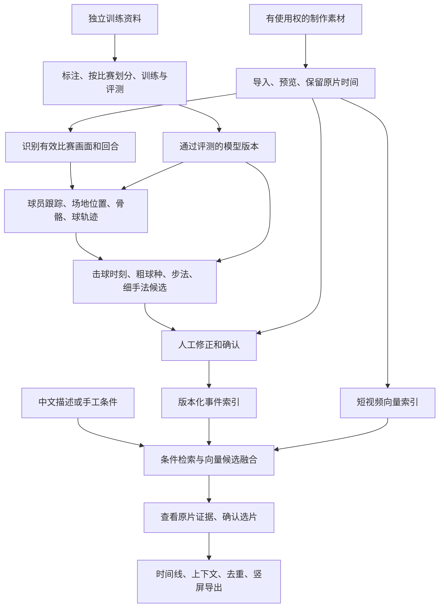

# 羽毛球检索与集锦：完整业务能力与落地方案

编写日期：2026-10-02。面向产品评估与后续排期。

现状依据：本地 `main` 的 `6db0064` 及截至2026-09-29保存的真实实验；开源入口于本次重新核查。本文件是方案，不是新增运行成绩；没有重跑模型，也不代表旧服务今天仍在线。正式达标状态继续以 [阶段验收表](STAGE_ACCEPTANCE.md) 为准。

快速阅读：先看第1节结论、第3节能力表、第7节投入与验收；需要判断具体训练对象时再看第4–6节。

## 1. 先看结论

**推荐做成“自动找候选、人工确认、可追溯成片”的产品。** 当前业务底座已有可运行基础；最需要补的是可靠的比赛事件，而不是再搭一套界面或从零训练大模型。

建议先支持**机位稳定、人物和脚部清楚的单打视频**。双打、频繁切镜、远端细手法、跨机位相似动作分别扩展，不把一种场景的成绩套到其它场景。这只是交付顺序，个人录像与转播、三个目标动作仍保留在总需求中。

| 可以做出的产品层次 | 可行性判断 | 最大前提 |
|---|---|---|
| 人工标注后，用中文条件找片段并做竖屏集锦 | 高；工程研究流程已通，仍需真人完成正式业务验收 | 真实身份、动作审核、素材用途与成片听感确认 |
| 自动预标回合、球员、球路和粗动作，人工修正后检索 | 中高；适合下一轮重点投入 | 把多个模型的时间轴、球员身份和事件串起来 |
| 自动识别展搓/收搓、后退小跳启动 | 有条件；小跳比细手法更适合先做骨骼实验 | 专家定义、清晰可见素材、独立标注；目前未达标 |
| 全自动理解任意比赛的战术意图、完整直播实时分析 | 高风险研究项，不作为首版交付承诺 | 稳定事件链、意图标注、因果模型和持续负载实测 |

**最重要的限制：画面没有拍清的手腕、拍面或脚部细节，训练更大的网络也不能可靠补回。** 因此，展搓/收搓先验证“人能否稳定分辨”，再决定训练投入。

## 2. 完整业务怎样串起来

训练资料可以训练模型；**训练原片及其衍生片段不能进入制作素材库或集锦**。模型应用到有使用权的制作素材后，才产生可供制作的候选。

这里有两个不同索引：**事件索引**保存“谁在什么时候做了什么”，适合球员和先后顺序；**向量索引**保存视频内容的数字特征，适合找相似候选。后者的相似分数不是识别准确率，也不能单独证明多拍顺序。

## 3. 能力清单：现在能用什么，还差什么

难度是基于本项目基础的工程判断：**低**=以已有组件接入为主；**中**=需要适配、标注和真实测试；**高**=明显受数据或识别效果制约；**研究级**=没有可承诺的达标路径。难度不等于工期，也不是论文结论。

“可用”均指注明范围内的研究能力；表中的短名称不是新增模型卡状态。

| 能力与业务需求 | 当前可用性 | 推荐实施与人工兜底 | 难度 / 责任 |
|---|---|---|---|
| 数据入库、来源、许可、去重、训练/制作隔离 | 已有实现和真实验证 | 继续按 Asset 清单只读引用原片；补真实比赛分组和可制作素材 | 低—中；library/platform |
| 给训练专用视频补标、纠正预标注 | 缺独立训练标注入口；现有制作入口会拒绝这些视频 | 新增隔离训练项目，复用标注工具并输出训练标注快照，禁止流入制作事件/时间线 | 中，需先补；platform/models |
| 流畅预览、逐帧、局部放大、保存标注 | 有界代理与原帧核查已通；流畅性未过 | 复用 FFmpeg、内置工作台和 Label Studio；定位约1秒目标帧回调等待，不先盲换解码器 | 中；platform |
| 有效比赛画面、回放、特写和回合切分 | 自动链未完成 | 镜头检测生成候选，人工修订回合；必要时训练小型画面分类头 | 中；models/platform |
| 谁在打球、同一个人如何跨帧关联 | 已有匿名跟踪，稳定身份未过 | YOLO姿态＋ByteTrack＋场地区域筛选；每场人工绑定姓名，切镜/换边重新核查 | 单打中，双打高；models |
| 球员在前场/后场、向哪里移动 | 姿态有输出，可靠场地位置链未过 | 每镜头人工确认球场对应点，OpenCV映射脚点；失效时不输出假坐标 | 中；models/platform |
| 羽毛球在哪里、球路怎样变化 | TrackNet真实小窗已通，仍有漏点 | 先复用；标记观测、缺失、推断，人工纠正重要窗口后再考虑微调 | 中—高；models |
| 每一拍何时击球、由谁击球 | 缺可靠自动事件 | 球轨迹与手腕运动提出候选，人工点选；训练击球时刻网络见第4节 | 高，优先补；models |
| 杀球、挑球、放网等粗球种 | BST权重已有，实际输入不合格，尚未跑通 | 先补连续姿态、球路和击球边界；不靠补零凑输入 | 中—高；models |
| 后退小跳启动及完整脚步过程 | 无训练好的目标模型 | 小型骨骼时序网络，必要时加脚部视频；细分普通后退、垫步、起跳击球 | 高；models＋专家 |
| 展搓/收搓细手法 | 无合格真值、无目标模型 | 清晰手/拍局部视频＋时序分类；可见性不足保留unknown | 高—研究级；models＋专家 |
| 技战术组合与意图 | 事件规则部分已有；战术统计/意图未实现 | 先做可验证的“后场球→上网”等序列与统计；意图只作待审核解释 | 事实中，意图研究级；models/platform |
| 中文理解和条件编辑 | 规则解析可用；本地0.6B实验未过 | 规则兜底，试更强小型指令模型或已配置端点；输出严格校验 | 中；platform/models |
| 从全库召回视频，而不只是一次实验排序 | Qwen3-VL/CLIP小窗特征已通；全库向量索引未接入 | 批量提取并版本化存储向量，接入 Candidate、过滤、去重和审核界面 | 中—高；platform/models |
| 多拍顺序、同球员、同回合查询 | 已有规则实现；自动事件缺失 | 先用人工事件形成可靠基线；允许中间穿插对手击球，不允许跨回合拼接 | 中；platform |
| 时间线、字幕、慢放、竖屏导出 | 技术链已通；人类内容/音画验收未过 | 默认保留全场，人工确认上下文、回放去重及音画；复用 FFmpeg | 低—中；render/platform |
| 模型切换、进度、取消、恢复、资源预算 | 基础调度已通；整场稳定性未过 | 增加分段检查点、失败区间、模型热运行及备份恢复实测 | 中；platform/models |
| 实时分析、上传示例视频找相似动作 | 尚未形成完整产品能力 | 先完成离线V1；实时与示例检索各自做独立评测 | 高；后续阶段 |

现有网页搜索直接查询事件表；目前模型真实产物大多 `events=[]`。Qwen3-VL成功的是指定小窗内的向量和排序，**还没有接成“中文自动搜索整个职业视频库”**。这是下一轮必须显式补上的业务接口，而不是换个模型即可自动获得的功能。证据见[平台搜索实现](../apps/platform/main.py)、[VL适配器](../packages/models/vl_embedding_reuse.py)及[本轮验收](ROUND_VALIDATION_2026-09-29.md)。

## 4. 具体要用或训练什么网络

以下“建议网络”是拟实施方案；只有注明“已运行”的组件有本机证据。冻结特征的意思是先保留预训练模型，只训练后面的小分类器，减少算力和数据成本。RGB就是普通彩色视频；PTS是原视频的帧时间；checkpoint是可恢复的模型存档；LoRA是只调整少量参数的微调方式。

### 4.1 比赛画面与回合：先做过滤，避免把回放算两次

- **输入/输出**：原视频 → 镜头区间、比赛/特写/回放候选、回合起止。
- **起步路线**：用 [PySceneDetect](https://github.com/Breakthrough/PySceneDetect) 找镜头变化；镜头变化不是回合边界。人工标回合和回放关联，先让后续模型只处理可信区间。
- **需要训练时**：冻结现有视觉编码器，训练“比赛远景/近景/其它”小分类头；回放再结合转播标志、速度、与原动作的重复匹配。不能只凭远景判断正在直播。
- **新增工作**：区间编辑、回放指向原动作、镜头切换后使旧跟踪和校准失效。先统计漏掉比赛区间的比例；过滤过严会让后面永远找不到目标。

### 4.2 球员、骨骼、场地位置：优先复用，不先训练人体基础模型

- **输入/输出**：有效比赛帧 → 人框、17个人体点、镜头内轨迹、可用的场地区域。
- **已有起点**：[YOLO11姿态](https://github.com/ultralytics/ultralytics)＋[ByteTrack](https://github.com/FoundationVision/ByteTrack) 已在本机真实运行；仍见漏人、重复框、脚踝错位。先加场地范围、跨帧连续性与人工纠正，按错误再微调检测/姿态网络。
- **场地位置**：先由人确认四个分布良好且不共线的地面对应点，用 [OpenCV单应变换](https://docs.opencv.org/4.x/d9/dab/tutorial_homography.html) 映射落地脚点。镜头移动、变焦和切镜后检查或重做校准；跳起的脚不满足地面假设。
- **身份与双打**：轨迹ID不等于姓名。首版人工绑定每场姓名/场端；换边重新关联。双打四人交叉、遮挡另测，不承诺直接继承单打效果。
- **边界**：平面映射适合地面位置；**不能把空中羽球的图像位置直接映射成真实三维球路或落点**。三维重建需要额外几何、假设或多机位，后置。

### 4.3 球轨迹与击球时刻：优先训练候选检测的小网络

- **球轨迹复用**：[TrackNetV3](https://github.com/qaz812345/TrackNetV3) 有作者代码和权重，本机已跑通。新职业片75帧中44帧有观测、31帧缺失；这不是准确率，也不够直接喂给所有下游网络。
- **先评估现成击球实现**：[Badminton-hit-detection](https://github.com/kwyoke/Badminton-hit-detection) 提供坐标序列GRU、训练notebook和权重入口，输出无击球/近端击球/远端击球。作者将14帧窗最后6帧内有击球记为阳性，所以输出不能直接当精确触球帧；本轮未核实明确许可，先作参考，取得许可依据再集成。[Automated Hit-frame Detection](https://github.com/arthur900530/Automated-Hit-frame-Detection-for-Badminton-Match-Analysis) 提供MIT代码的Transformer路线，完整权重获取与本机运行仍需核验。二者均未在本项目实测，不绕过输入/许可核查。
- **击球网络建议**：先规则候选，再训练小型 **TCN（沿时间看连续变化的卷积网络）**。输入连续球点及其速度、两人手腕/身体位置、各项可见性与缺失标志；输出逐时刻“谁可能击球”的概率及时间区间。可借鉴 [TCN作者实现](https://github.com/locuslab/TCN)，它不是现成羽球击球模型。
- **起步配置建议**：约1–2秒上下文、4层残差时序块、64–128通道，作为可调的小模型基线。轨迹断裂时保留缺失，不把插值当观测；球突然转向也可能是误检、落地或切镜，不能直接当击球。
- **标签与验证**：人工标触球时刻或不确定范围、击球者，以及落地/误检/挥拍未触球等难负例；先报告±100ms和±250ms容差下的结果，再冻结产品门槛。触球附近音频可作后续辅助，转播声音可能不同步，不能作唯一依据。
- **补轨选择**：作者InpaintNet也已取得，但本项目原固定失败窗口不满足其适用条件。保留该失败，先改善观测或人工修正；新窗口另立实验，不覆盖旧失败。

### 4.4 粗球种：先跑通BST，再决定是否微调

- **模型**：[BST](https://github.com/Va6lue/BST-Badminton-Stroke-type-Transformer) 融合连续骨骼、场地位置和羽球轨迹，作者提供实现及权重；适合作为已定位单拍的粗分类起点。
- **本机实际阻塞**：固定52帧窗中25帧连续缺球，远端球员特征不完整；没有生成合格输入并执行正式前向。先补前置数据，不能把问题解释成5090算力不足。
- **要补的标签**：真实前/当前/后击球边界、同时间轴双人轨迹、校准、粗球种；已有公开标签先核实类别及时间语义，再映射。
- **若仍不适合**：用同一份人工确认输入比较BST与小型TCN；之后才对目标标签微调。模型内“未知球种”类别，与产品“看不清所以不判断”分开处理。
- **可用边界**：作者模型依赖未来上下文，当前路线适合离线；它不直接输出展搓、收搓，也不是可原样部署的直播模型。

### 4.5 后退小跳启动：骨骼时序为主，脚部视频作补充

- **输入/输出**：同一球员约2–4秒连续骨骼、场地移动、脚部可见性 → 目标是否出现、起止与阶段候选。
- **建议先训**：TCN；与 [MMAction2的ST-GCN](https://github.com/open-mmlab/mmaction2/tree/main/configs/skeleton/stgcn) 对照。ST-GCN利用关节连接和时间变化，两者均须用本项目标签训练，不是下载后就认识这个步法。
- **训练对象**：准备→卸载/离地→落地→后退的连续过程，具体判据由专家确定。加入原地垫步、普通后退、转身、起跳击球等已确认难负例；缺脚部证据的unknown单独保留。
- **适配要点**：统一左右手、机位、身体尺度，输入包含关键点置信度/缺失标志。若普通骨骼分不清脚是否离地，再加脚部RGB短片特征；不先上整场大视频网络。
- **可行性**：5090适合这种小模型原型，主要风险是脚部可见性和跟踪连续性。先有网前细手法的可见性结论，再按数据条件推进；若细手法受阻，可并行做步法，但不能替代原细手法验收。

### 4.6 展搓/收搓：需要局部视频，骨骼单独通常不够

- **输入/输出**：同一球员触球前后的手、球拍局部视频，加完整上肢和球路上下文 → 展搓/收搓/已确认其它动作，或拒绝判断。
- **建议先训**：冻结预训练视频编码器，训练小分类头；可选 [VideoMAE](https://github.com/MCG-NJU/VideoMAE) 的公开模型作为起点。先比较全身窗口与手/拍局部窗口，确有收益再有限解冻微调。该仓库没有本项目细手法权重。
- **实际工程**：现有17点人体姿态没有拍面和手指；先人工校正局部裁框，不假设已具备球拍追踪器。裁框抖动、远端小目标、运动模糊都要记录。
- **采样建议**：先试触球前后约1–2秒、16–32个原始帧；按真实帧率取样并保留原PTS。普通慢放便于观察，插帧/生成式超分不产生新的可信触球证据。
- **停止条件**：专家无法稳定区分，或可判样本太少，就保持粗“网前处理”候选与unknown，补清晰自摄素材；不继续用大模型硬拟合背景、球员或赛事标识。

### 4.7 中文视频检索：复用嵌入模型，补索引和业务接入

- **已经运行**：[Qwen3-VL-Embedding-2B](https://github.com/QwenLM/Qwen3-VL-Embedding) 及CLIP对照；4秒/6秒真实窗、每窗6帧产生了有限向量与排序。峰值分配显存约4.42GB，仅代表该配置的推理实验。
- **必须补做**：按有效回合/动作候选切窗，批量生成向量；为每条保存asset、起止、模型版本、用途、源hash和索引版本。先用精确向量比对做小库基线，规模需要时接 [Faiss](https://github.com/facebookresearch/faiss)。
- **查询时**：中文条件形成QuerySpec → 规则候选与向量候选分别召回 → 按素材用途、球员、回合、先后关系过滤/融合 → 返回统一Candidate和原片证据。未知条件须显示缺失，不能冒充满足。索引重建、增量更新和旧版本失效也需要实现。
- **何时训练**：先比较规则＋人工事件、现成视频向量、融合三条路线。只有确认“向量排序差”而不是漏拍/错人/时间不对后，才用相关与不相关的查询片段对做轻量微调。
- **中文解析**：规则继续兜底；可试 [Qwen3](https://github.com/QwenLM/Qwen3) 的4B级指令模型或已配置端点，用JSON/schema校验，失败退回可编辑条件。它只理解查询，不负责断定视频事实；现有0.6B的0/24、2/24失败记录保留。4B尚未在本项目验证。
- **可选后续**：[ActionFormer](https://github.com/happyharrycn/actionformer_release) 有时间定位代码、配置及通用数据权重，可训练“动作在哪里开始结束”；通用权重不含本项目细标签。先把已定位候选做好，不一开始同时训练分类、定位、检索所有网络。

### 4.8 技战术：先记录事实序列，再考虑意图

- **先能兑现的需求**：同一球员“后场击球→随后上网”、连续压某区域、某种球路后对手怎样回球。先由已审核事件做规则查询、计数和区域统计，不需要额外大模型。
- **可参考的工作**：[CoachAI / ShuttleSet / ShuttleNet](https://github.com/wywyWang/CoachAI-Projects) 提供逐拍数据与基于历史事件的预测研究。预测下一拍，不等于识别本次视频，也不能倒过来作为已观察事实。
- **意图层**：“诱导对手起高球”“故意调动重心”等只能作为假设；需专家定义、上下文和不同解释的比较，LLM说明要引用事件并允许“不确定”。先不训练独立战术意图网络。
- **复现边界**：本次10月2日复核，[MADR项目](https://yixiang1120.github.io/MADR-project-page/) 的代码入口仍为Coming Soon；其路线依赖已标注逐拍日志，不能当作已拿到的原视频全自动方案。

三个首批目标不宜硬塞成互斥的“三分类”：一次片段可能同时含步法和手法，应分别预测、分别记录可见性，再用事件关系组合。

## 5. 数据准备与标注：先花小成本验证能不能做

### 已有数据能提供什么

| 已有资源 | 可直接利用 | 仍要处理 |
|---|---|---|
| [Fine-Badminton 2026完整公开包](https://zenodo.org/records/20292976)：10视频、约10.72小时、9817行标注 | 真实前处理实验、粗球种候选；可建立训练标注集，但要新增独立入口 | 是processed clips，不是10份未经剪辑整场；帧号起点/端点、双语类别、重复行、比赛分组未全部确认，不能直接当正式Event真值 |
| BFMD完整121文件 | 研究逐拍字段、姿态/球路格式和描述 | 无原视频/PTS；部分特征和文字是派生或生成结果。未对齐原片前不能算视觉训练真值 |
| 原有制作库5段独立下载小样及1条派生 | 界面、检索、导出研究流程 | 数量和来源不足以证明职业整场泛化；个人录像效果仍需另收数据 |

细手法标签不能由“搓球”“网前球”粗标签直接生成。已有训练包仍保持training_only；视频、标注、代码和权重的许可分别记录。[数据语义问题](issues/library-training-annotation-semantics.md)包含逐项证据。

**要先补一个独立训练标注工作区。** 现有制作素材导入、预览和Label Studio对接会拒绝training_only，不能直接把新训练包丢进现有页面补标。方案是新增隔离的训练项目、受控媒体读取、预标注任务与标注导出，复用现有标注工具；原片继续只读引用，代理/标签/特征继承training_only。训练快照只交给训练与评测，不能自动进入制作Event、候选或时间线，也不能靠改用途字段绕过门禁。

### 建议的起步量和成本

以下是**工程预算假设，不是论文保证的最低数据量或成功承诺**。先计时20段、检查可见性，再决定扩量。

| 用途 | 建议起步量 | 达到什么才继续 |
|---|---|---|
| 定义和可见性试验 | 每目标先10个疑似正例＋易混对照，由专家与另一审阅者独立看 | 能解释分歧、能给出必要可见证据；否则先补素材/定义 |
| 三目标可见性小集 | 每类30–50正例＋近似等量难负例，另30–60个unknown；约210–360段 | 形成专家锚点和按机位的可判比例；这是开发集，不拿来宣称泛化 |
| 击球时刻基线 | 先200–500个人工确认触球点及易混非击球片段 | 能评估漏检、错人、时间误差，决定是否扩大；不等于足够训练成熟检测器 |
| 小型目标分类首轮 | 每类200–500正例＋约等量难负例，三目标约1200–3000训练段 | 看验证集学习曲线与典型错误，避免只学同一球员/背景 |
| 独立验证/测试 | 验证每类50–100正例，测试每类约100正例，均另配难负例 | 按不重合比赛/录制组取样；测试不足不宣布支持该类 |
| 查全率与整场稳定性 | 另选连续回合/比赛区间，把所有目标机会和不可判区间穷尽标完 | 才能计算召回；只审核搜索返回的候选不能知道漏了多少 |

三目标训练、验证、测试合计约2100–4200个目标判断单元；同一视频片段可有多个目标标签，不能把它算成多个独立来源。上述预算不能替代回合、姿态、球路纠正和整场穷尽审核的额外成本。

自动事件链试点可先选3场已确认比赛中的20–30个完整回合，逐拍标击球者/时刻、镜头和场地，并纠正球心与人体关键帧。这个小集用于找系统性错误和计量标注成本；不是正式留出评测，不用它证明泛化。

训练/验证/测试**先按真实比赛或录制会话划分，再切片**。同场相邻片段、回放、转码、重传都归同组；文件名不同不证明是不同比赛。建议首轮争取6–10个已确认来源组，并为验证/测试各保留多个组；若某类只出现在一场，继续补源，不随机切帧凑比例。公开基模型可能接触过的比赛也要记录；最终补新自摄留出材料检查污染和跨域问题。

人时参考：已找到、切好的1000段，每段初标45–90秒＋20%同耗时复核，约15–30人时；细手法若每段3分钟，约60人时。该算式**不含找片、专家定义、全量双人复核、分歧仲裁和密集轨迹修正**。定义小集与最终关键测试需独立复核，不能把20%抽查当其完成标准。

## 6. 5090能做什么，资源如何估算

| 任务 | 单张5090的判断 | 实施限制 |
|---|---|---|
| 已有姿态、TrackNet、2B视频向量推理 | 已有真实小窗成功证据 | 不推出整场实时；限制分辨率、窗口、batch并串行共享GPU |
| 冻结特征＋TCN/骨骼分类头 | 适合作为首轮训练方案，尚待真实训练验证 | 先训练100–200步测速度/显存，再估总时长 |
| 小视频模型局部微调、2B级LoRA | 有合理可行性，需独立试验 | 激活、视频帧数、分辨率和优化器决定显存；推理占4.42GB不等于训练只需这些 |
| 长视频、大分辨率、8B全参训练 | 不纳入首轮可落地承诺 | 改短窗、冻结主干、减batch；没有依据就不先购买更大算力 |
| 直播实时整链 | 尚未证实 | 模型常驻、采集/解码/推理/排队全链测量；依赖未来帧的模型不能假称实时 |

已有软件轨迹短窗曾测active RTF约0.606：表示该定义下的计算时间约为视频时长的0.606倍，**不等于摄像头到结果的持续端到端延迟**。实时实验需先定义允许延迟，再连续回放/采集至少30分钟，报告P95延迟、队列积压、丢帧和精度；这是一项拟新增断言，开发前纳入R-07c子用例，不改现有NOT_RUN状态。

2026-09-29项目容量快照约50.74十进制GB，10月2日本次没有重扫；下一轮开工前重测。总上限仍为700GB，按已有owner配额执行，不因剩余较多就把整场拆成全部JPEG。

向量容量可先粗估：100小时素材、每2秒一个2048维float32向量，约18万个向量、1.47GB纯向量；另有元数据/索引开销，不能把1.47GB当总空间。抽窗步长也影响漏检和推理量，要在验证集比较。优先存原片引用、结构化特征和少量核查图，不重复复制原片。

FFmpeg CPU路径保留；9月29日同版本短片对照里NVENC更慢且文件更大。只有分项计时证明解码/编码是瓶颈后，再在隔离环境评估 [TorchCodec](https://github.com/meta-pytorch/torchcodec) 或硬件解码，不能仅加GPU开关就算加速完成。

## 7. 实施顺序与每一步如何验收

下面是后续工作包，不是新增阶段计数。沿用固定用例ID；开发前把新增断言细化为子用例并登记版本。**全部必需项PASS才算阶段达标；本次写方案不改变现有状态。**

| 顺序 / 固定ID | 具体交付与验证输入 | 预期结果与判定方法 | 目前状态 / 未达标原因 |
|---|---|---|---|
| 1 数据可判：S0-03/04、R-04b | 独立训练标注工作区、三目标可见性小集、专家定义、原片对齐、比赛分组、20–30条真实查询 | 训练标注能回写且不能进入制作链；保存双人分歧与裁决；划分不泄漏，unknown不做负例；每类每来源数量可查 | S0 BLOCKED：缺定义/正式真值与分组；独立训练入口NOT_RUN，旧用途隔离PASS保留 |
| 2 真人闭环：S1-04、S4-03/04 | 一次真实“确认身份→标注→检索→选片→导出→完整审片” | 不串人、不重复回放、有完整动作上下文；真人审核当前修订；音画容差测试前冻结 | BLOCKED / NOT_RUN：现有agent演示及技术QA不能代替 |
| 3 自动事件：S2-03、R-07a/b/e | 固定回合内跟踪/校准/球点→击球→粗动作，保留全部失败区间 | Event能回到原片；对人工真值报告漏检、错人、时间误差和缺失；量化门槛先冻结 | S2-03 NOT_RUN；轨迹子项PASS，位置/BST仍BLOCKED |
| 4 检索接通：S3-02/03/04 | 修复或替换解析器、持久向量索引、统一Candidate；同集比较规则/向量/融合 | 先复跑原24开发探针；再测独立查询与同预算审核量；外部端点可用才测其联调 | 解析原实验FAIL；端点与质量BLOCKED；全库向量接入未做 |
| 5 定点训练：S2-04、S5-01/02 | 先击球/粗类，再按可见性结论训练细手法与步法；保存学习曲线和消融 | 验证集调参；未触碰的test只作最终比较；每次记录失败与退回原因 | BLOCKED：监督真值和基线误差不足 |
| 6 V1交付：S5-03、G-01/02/03 | 支持范围、整场任务、重启/取消、容量、备份恢复及人类完整操作 | 只开放达到冻结门槛的标签/来源/机位；未通过能力明确不可用 | BLOCKED：尚缺质量、整场稳定性和正式人类验收 |
| 7 后续：V2-01/02、R-07c | 示例视频检索；独立的持续实时试验 | 同语义与细节相似分别测；直播同时满足因果性、精度、延迟与积压要求 | NOT_RUN：不提前占用首版关键路径 |

检索质量沿用 [ACCEPTANCE](ACCEPTANCE.md)：P@20≥0.80、完整真值上的候选召回≥0.80是**候选研究门槛**，不是已达到的成绩。开发期冻结后按分层测试；每类至少30个可判正例且不止一场只是必要条件。候选不足20时报告实际K、零返回及unknown，不用删难例或放宽窗口换取通过。

### 工作量怎样评估

按“一名熟悉现有仓库的工程师＋可及时配合的标注者/教练”估算，以下为初始工作包预算，**不是模型达标工期承诺**；数据到齐、任务范围冻结后再更新。

| 工作包 | 工程投入粗估 | 最大变动因素 |
|---|---:|---|
| 独立训练标注入口、标注协议、数据对齐和真人闭环补齐 | 6–12人日 | 训练/制作隔离、专家反馈、原片语义与界面体验；标注人时另计 |
| 固定单打镜头的前处理、身份/校准、击球与粗事件 | 10–20人日 | 漏球、错人、转播切镜；可先人工纠正关键输入 |
| 持久向量索引、解析器和Candidate接入 | 5–10人日 | 过滤一致性、增量更新、中文条件保真 |
| 一个细目标的小模型训练、评测与平台接入 | 5–10人日/目标 | 假设合格标签已到齐；不包括解决“画面看不清” |
| 有限范围试用与整场稳定性 | 4–8人日 | 长任务恢复、人工审核负担、性能瓶颈 |

这些区间不能直接相加成发布日期：部分可并行，细目标可能因不可见性停止。应先投入第1个工作包，拿到可判比例、20段标注计时和真实错误分布，再决定下一笔投入。

## 8. 模块交接要落到哪些具体产物

| 模块 | 下一轮必须交出的东西 | 被谁使用 |
|---|---|---|
| library | 已核实比赛分组、原片/标注时间映射、训练与制作用途、许可及下载清单 | 标注、训练、素材导入 |
| models | 带源时间/球员/缺失原因的候选Event、版本化特征、可复现训练脚本、checkpoint和分层评测报告 | 工作台审核、事件/向量索引 |
| platform | 隔离训练标注工作区；校准/身份/回合/细标签审核入口、索引版本、Candidate适配、训练配置与真实指标/错误展示 | 用户完整业务操作；训练快照不发布到制作事件库 |
| render | 消费当前审核过的Timeline、保留上下文/回放关系、输出MP4/源映射/技术与人类QA | 可确认的完整竖屏成片 |

模型计算仍在WSL隔离环境；平台控制面不装训练框架，模型不直接写业务SQLite。训练配置需保存数据/划分版本、标签定义、模型和代码版本；训练进度要有真实loss/验证指标、checkpoint、取消与续训记录，不能把现有推理任务界面当已实现完整训练管理。

新增镜头校准、密集轨迹和可见性字段先用模块附加记录，按asset/event/revision关联；需要进入公共接口时再兼容扩展合同。不同模型共用源PTS和身份映射，不各造一套时间/球员编号。

## 9. 开源与复现依据怎么理解

“有代码”“有公开权重”“本机运行过”“本产品效果达标”是四件事。上文每个候选均给作者或官方入口；本次网页核对只是确认可复用依据，没有安装或重新复现其论文成绩。

| 分组 | 资源 | 本项目应采用的结论 |
|---|---|---|
| 已有真实小样运行 | FFmpeg、YOLO11/ByteTrack、TrackNetV3、Qwen3-VL-Embedding及CLIP对照 | 复用现有锁定版本；工程运行成功，效果和持续吞吐仍按各自报告 |
| 权重已取得但输入受阻 | BST、TrackNetV3配套InpaintNet | 先解决真实输入，不能标成完整可用模型 |
| 有实现/通用模型，可做新实验 | PySceneDetect、TCN、MMAction2/ST-GCN、VideoMAE、ActionFormer | 本项目尚未完成对应训练/复现；通用数据权重不是羽球细动作权重 |
| 有算法工具，不是识别模型 | OpenCV、Faiss、[Label Studio](https://labelstud.io/tags/timelinelabels)、[FFmpeg](https://ffmpeg.org/documentation.html) | 分别负责几何、检索、标注、媒体处理；不能替代动作真值 |
| 有针对性代码但还需核验 | 两个击球检测项目 | 有训练或推理路线；权重完整性、许可和输入语义逐项核实后再选，尚未本地复现 |
| 数据/研究方向 | ShuttleSet/CoachAI、MADR、[DSTA论文](https://arxiv.org/abs/2605.23355) | 用于字段与路线参考；MADR代码仍Coming Soon。DSTA本次未核实正式作者代码/权重，只能列论文/数据方向，不能称可直接复现 |

代码/权重/数据各自核对许可。现有YOLO方案记录为AGPL-3.0，FFmpeg构建及研究数据也有各自条件；若准备公开商用，应先审查组件组合与素材权利，而不是把“能下载”当“可商用”。数据用途继续遵守本项目既定隔离规则。

现有证据入口：[研究实施验收](ROUND_VALIDATION_2026-09-29.md)、[阶段总表](STAGE_ACCEPTANCE.md)、[标注与评测细则](models/annotation-and-evaluation.md)、[模型环境与来源](models/SOURCES.md)、[4秒/6秒向量实验](experiments/integration-vl-window-acceptance-20260929.md)。
