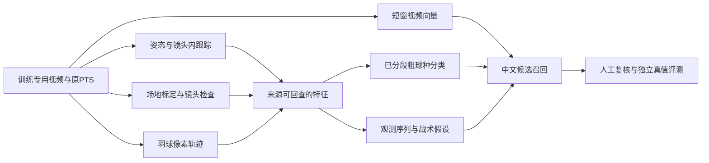

# 动作、位置、轨迹与战术的复用路线

核查：2026-09-29。此文件记录一手来源和选择依据；实际下载、推理、失败与验收结果由 `docs/status/models.md`、`docs/experiments/models-*` 提供。论文成绩不作为本机成绩。

## 本轮流水线

这批训练视频不连接集锦制作链。模型实验可生成诊断图及数据，仍继承训练用途。

## 组件选择

| 任务 | 候选与来源 | 接口与限制 |
|---|---|---|
| 羽球轨迹 | [TrackNetV3作者代码/权重入口](https://github.com/qaz812345/TrackNetV3) | 逐帧2D球点/缺失；补轨另记推测。原版全片中位背景、重叠窗口汇聚、二阶段Inpaint均属离线信息，不能当零等待实时 |
| 视频召回 | [Qwen3-VL-Embedding-2B官方模型](https://huggingface.co/Qwen/Qwen3-VL-Embedding-2B) | 中文与有限短窗生成向量；先零样本运行，不把相似度当置信度或准确率；新隔离依赖环境 |
| 粗动作 | [BST作者实现](https://github.com/Va6lue/BST-Badminton-Stroke-type-Transformer)、[作者权重目录](https://drive.google.com/drive/folders/1D4172WZDJWPvpJdpaHDhy_cA-s8F-zR5) | 真实双人17关节、场地位置、球轨迹按作者方式归一化。25类为12粗球种×上下场及unknown，非25细手法；分类头不发现动作边界，原裁片含未来击球上下文 |
| 球员姿态/跟踪 | 已有COCO17基线；[YOLO11官方模型](https://huggingface.co/Ultralytics/YOLO11)与[ByteTrack接口](https://docs.ultralytics.com/modes/track)作为轻量对照 | 显式镜头内track_id，不当运动员姓名；场边人物、遮挡和双打另测；YOLO代码/权重许可单列AGPL |
| 场地位置 | [MonoTrack独立court-detection](https://github.com/jhwang7628/monotrack/tree/main/court-detection)的线检测+几何拟合；最小人工四角校准基线 | 该C++子目录独立BSD-3-Clause、不需模型权重；默认构建会抓OpenCV3.4.12源码，先评估隔离成本。默认中间帧不属在线校准；地面H只用四个地面角点，不混两网柱顶点 |
| 逐拍预测 | [ShuttleNet作者实现](https://github.com/wywyWang/CoachAI-Projects/tree/main/Stroke%20Forecasting) | 历史逐拍记录预测下一球种/落点，未核实可直接加载的官方checkpoint；不是视频直接识别战术意图 |

球员脚点与地面单应变换可以形成位置证据；跳起/遮挡须标不可靠。空中羽球的2D像素点不通过地面H冒充真实落点。手工场地校准需标manual并记录适用镜头，不能算自动球场检测通过。

BST替换作者姿态提取器会产生输入域差异。可先验证作者真实预提取输入，再验证本项目原视频前处理；随机/零坐标只可当合同烟测，不能冒充真实动作流水线成功。

## 实时与战术输出边界

每个流式结果记录被判断事件PTS、最后使用的输入PTS、发出时间。按源PTS节奏送帧，报告首次响应、P50/P95延迟、积压、丢帧、分阶段时间与显存；GPU计时同步。离线整场吞吐、冷启动和稳态实时能力分别记录，门槛见R-07c。

战术层先从可复核事实开始，例如同一球员后场→前场移动、逐拍区域/球种序列，附源事件和未知项。高级战术名称是由观测支持的假设，不能将“故意诱骗、针对弱点”等叙述作为直接视觉真值。下一拍预测与战术检索也分别验收；未找到权重时保留unavailable，不伪造预测。

细标签展搓、收搓、后退小跳仍须定义可见性、人工真值和独立比赛测试。新公开粗球种标注不自动解除该条件。

## 更贴近战术检索的补充研究

[MADR作者页](https://yixiang1120.github.io/MADR-project-page/)提供CVPR Findings2026论文，代码仍标Coming Soon。[官方附录](https://openaccess.thecvf.com/content/CVPR2026F/supplemental/Zhang_From_Alignment_to_CVPRF_2026_supplemental.pdf)已公开A1结构化日志与A2提示词配置：本轮PDF直开403，但搜索索引读到相关正文，尚未逐页核对图A1–A7，不能声称已取得完整实现。作者主论文实验使用ShuttleSet人工game logs并补姿态叙述，离线生成战术文字，再进行检索/重排；不等于自动原视频抽取或比赛直播实时理解已达标。

可复用方向是 `事件/回合/拍序/球员/源PTS → 已观测球种与区域 → 中文事实模板 → 候选检索`，每项携来源与unknown。高级叙述可分facts/tactical_hypotheses/unknowns并强制事件引用，先不增加LLM权重。上述字段/分组是本项目建议，不冒称MADR原文提示词。缺原始球路、球员关联和专家相关性判断时，战术效果仍未验证。

[CoachAI-Plus](https://github.com/KuangDW/CoachAI-Plus)的Tactic_Evaluation有可读规则，但本轮未核实根代码许可，且源码存在函数对象未调用即比较的可疑逻辑；不直接复制整包。RallyNetv2的行为模仿/模拟权重也不能改名成视频战术识别模型。

## 补充标注数据状态

[BFMD作者仓库](https://github.com/Ning-D/BFMD)和[公开Drive](https://drive.google.com/drive/folders/1wQr4DpMbx-e8jFnvOH9WUJXxfXgTC1IJ)提供标注与比赛索引，不附原视频。初查116个标注目录文件与5个根文件约1.825GB；library进一步核对为115个有效JSON及1个.json.bak，备用文件不计有效标注。最终选择及下载后字节/hash以library报告为准。公开包声明1058回合/11301拍，与论文规模不同；19场索引不当成19场已下载视频。双打标注范围有限，球轨迹含模型预测/推断，不能全部算human真值。用于训练专用补充，先按视频ID和时间轴匹配，不能随意套到另一数据集。

[DoublesEval官方仓库](https://github.com/Chengjt1999/DoublesEval)当前只有README/许可，代码和数据尚无可下载入口，登记BLOCKED；其论文里的职业双打不计本地已取得素材。
